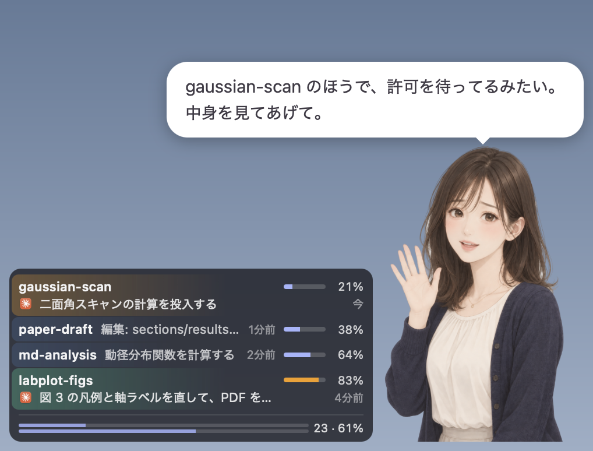

# marimo

marimo は、AI のコーディングエージェントのセッションの状態を画面上で知らせるデスクトップウィジェットです。現在、Claude Code、Codex、Hermes Agent、OpenCode、Antigravity の五つに対応しています。

画面の隅に立つキャラクターが、各セッションが作業中なのか、承認を待っているのか、終わったのかを表情と吹き出しで伝えます。横のパネルには、セッションごとのコンテキスト使用率と、Claude Code、Codex、Antigravity アカウントの利用枠が表示されます。他の作業をしていても、エージェントのウィンドウを直接確認することなく進捗を把握できます。

<p align="center">
  
</p>

この画面では、gaussian-scan のセッションがコマンドの実行許可で待機しているため、立ち絵が手を振って吹き出しで通知しています。パネルには承認待ち（橙）、作業中（青）、完了（緑）のセッションが 1 件ずつ並び、最下段がアカウント全体の利用制限を表示します。

> [!NOTE]
> marimo は有志が作った非公式のツールです。Anthropic をはじめ、marimo が対応しているツールのどの開発元とも関係がなく、どの開発元が承認したものでもありません。Claude と Claude Code は Anthropic の商標です。Codex、ChatGPT、Hermes Agent、OpenCode、Antigravity、Gemini などのそのほかの製品名は、それぞれの会社の商標または登録商標である場合があります。

## 目次

- [marimo が見せるもの](#marimo-が見せるもの)
- [対応しているツール](#対応しているツール)
- [動作環境](#動作環境)
- [インストール](#インストール)
- [不具合の報告と貢献](#不具合の報告と貢献)
- [ライセンス](#ライセンス)

使用方法、見た目の変更、開発者向けの詳細は以下の文書を参照してください。

| 文書 | 書いてあること |
| --- | --- |
| [marimo の使い方](docs/usage.md) | 起動と終了、設定、パネルの見方、セッションへの移動、立ち絵の表情、利用制限、更新、困ったとき、アンインストール |
| [表示を変更する](docs/customize.md) | セリフの変え方、自分のキャラクターの作り方、素材の作り直し方 |
| [marimo の開発](docs/development.md) | ソースからのビルド、`install` が書き換えるもの、ファイルとデータ、プライバシー、テスト、動作確認の状況、仕組み |

## marimo が見せるもの

### 立ち絵、吹き出し、パネルの役割

marimo のウィンドウは、立ち絵、吹き出し、パネルの三つから構成されます。

<p align="center">
  
</p>

- **立ち絵**は、全体の状態を視覚的に伝えます。状況に応じてキャラクターの表情が変化します（[立ち絵の表情](docs/usage.md#立ち絵の表情)を参照）。
- **吹き出し**は、承認待ち、完了、エラーになったときに立ち絵の上に表示され、どのリポジトリで何が起きたかを短文で表示します。
- **パネル**は、待機以外のセッションを 1 件ずつ並べます。各セッションには、状態の色、ツールのアイコン、リポジトリ名とチャットのタイトル、コンテキスト使用率、現在の作業の短い要約、最後のツール呼び出しが発生してからの時間が表示されます（[パネルの見方](docs/usage.md#パネルの見方)を参照）。

初期状態では、小春（こはる）と、Claude Code マスコットの Clawd がキャラクターとして選択できます（[設定](docs/usage.md#設定)を参照）。

### 状態の種類と優先度

marimo では、セッションを以下の五つの状態に分類します。

| 状態 | 意味 |
| --- | --- |
| 承認待ち | エージェントが利用者の操作待ち |
| エラー | 応答が途中で失敗 |
| 作業中 | エージェントが思考中、ツールの使用中、サブエージェントの実行中 |
| 完了 | 応答が終了し、実行中のサブエージェントがない状態 |
| 待機 | 何も実行していない状態 |

どのイベントでどの状態になるかは、[状態の決め方](docs/development.md#状態の決め方)に書いています。

完了とエラーの場合、未読状態では表示され続け、既読にすると自動的に折り畳まれます（[完了とエラーの既読](docs/usage.md#完了とエラーの既読)を参照）。

複数セッションで作業中の場合、立ち絵には最も優先度の高い状態が表示されます。優先度は高い順に、承認待ち、エラー、作業中、完了、待機です。

## 対応しているツール

ツールに関係なく `marimo-hook` が現在の状況を取得します。

| ツール | 状態を受け取る仕組み |
| --- | --- |
| Claude Code | フックと statusLine |
| Codex | フック |
| Hermes Agent | シェルフック |
| OpenCode | プラグイン |
| Antigravity | フック |

登録のしかたは[インストール](#インストール)に書いています。

フックは、特定のイベントが起きたときにツールが呼び出す外部コマンドです。statusLine は、Claude Code の CLI（端末で動かすコマンドラインインターフェース）が画面下部の一行を表示するために呼ぶ外部コマンドで、marimo はここからコンテキスト使用率と利用制限を受け取ります。

ツールによって、パネルに出せるものと、パネルのセッションを押したときの移動先が違います。

| 項目 | Claude Code | Codex | Hermes Agent | OpenCode | Antigravity |
| --- | --- | --- | --- | --- | --- |
| タイトル | セッションのタイトル | セッションのタイトル | Discord のチャンネル名か `DM` | セッションのタイトル | セッションのタイトル（CLI では非対応） |
| コンテキスト使用率 | CLI ではパーセント、デスクトップアプリの Code タブではトークン数 | パーセント | パーセント（上限不明の場合トークン数） | パーセント（上限不明の場合トークン数） | トークン数 |
| 承認待ち | 表示 | 表示 | 表示 | 表示 | 表示 |
| 利用制限 | 5 時間 / 7 日 | Codex が送ってきたウィンドウ | 非表示 | 非表示 | 5 時間 / 7 日 |
| セッションを押したときの移動先 | ターミナル、デスクトップアプリの会話 | ターミナル、デスクトップアプリの会話 | Discord のチャンネル | ターミナル | ターミナル、デスクトップアプリの会話 |
| サブエージェント | メインの作業として表示 | メインの作業として表示 | メインとは別作業として表示 | メインの作業として表示 | メインの作業として表示 |

各セッションのアイコンで実行中のエージェントツールを判別できます（[パネルの見方](docs/usage.md#パネルの見方)を参照）。セッションをクリックした場合の動作は[セッションへ移動する](docs/usage.md#セッションへ移動する)に、利用制限の表示については[利用制限の表示](docs/usage.md#利用制限の表示)に記載しています。

## 動作環境

marimo は macOS で動作を確認しており、Windows 11 でも大半の機能を確認済みです。Linux では確認していません。

Claude Code は 2.1.139 以降が必要です。marimo は、このバージョンで加わった exec form という書き方でフックを登録するためです。OpenCode は、v2 の端末から実行するセッションのみ対応します。

[動作確認の状況](docs/development.md#動作確認の状況)に、各ツールの詳細な対応状況を記載しています。

## インストール

以下に示す 1. から 3. は初回実行時の手順です。バージョン更新は 4. のスクリプトで実行します。コマンドはリポジトリの直下で実行してください。

### 1. ビルドする

最初の導入では、リポジトリを clone して自分でビルドします。必要なツールとそのバージョンは[必要なもの](docs/development.md#必要なもの)に記載しています。

まず、各ツールから呼ばれるコマンド `marimo-hook` をビルドします。

```bash
cargo build --release -p marimo-hook
```

次に、画面部分の依存を導入し、Tauri でアプリをまとめます。`npm run tauri -- build` は、画面部分のビルドと Rust 側のビルドをまとめて実行します。

```bash
cd app
npm install
npm run tauri -- build
cd ..
```

### 2. 各ツールに登録する

`marimo-hook install` は、Claude Code のフックと statusLine を登録し、Codex のフォルダがあれば Codex のフックを、OpenCode の設定のフォルダがあれば OpenCode のプラグインを、agy の設定のフォルダ（`~/.gemini/config`）があれば Antigravity のフックを登録します。

最初に `--dry-run` を付けると、ファイルを書き換えずに、変更後の settings.json と変更点だけを表示します。

```bash
./target/release/marimo-hook install --dry-run
```

内容に問題がなければ、`--dry-run` を外して実行します。`install` は書き換える前に settings.json のバックアップを作成します（[フックと statusLine の登録](docs/development.md#フックと-statusline-の登録)を参照）。

```bash
./target/release/marimo-hook install
```

インストール終了後、実行中のツールを再起動してください。Codex では、さらに Codex CLI の `/hooks` で marimo のフックを信頼してください。Hermes Agent は `install` では登録しないので、[Hermes のフック](docs/development.md#hermes-)のフックの手順で手動登録します。

### 3. アプリを起動する

macOS では、`marimo.app` を `/Applications` へコピーして起動します。初めて開くときに macOS が「開けません」と警告した場合は、[ad-hoc 署名について](docs/development.md#ad-hoc-署名について)の手順で開きます。

```bash
cp -R target/release/bundle/macos/marimo.app /Applications/
open /Applications/marimo.app
```

Windows では、`target\release\bundle\nsis\` にできる `marimo_<バージョン>_x64-setup.exe` を実行します。アプリは `%LOCALAPPDATA%\marimo\marimo.exe` に作成され、スタートメニューにショートカットが作成されます。

起動すると画面の右下に立ち絵が現れ、macOS ではメニューバーに、Windows では通知領域にアイコンが表示されます。ログイン時に自動起動させる場合は、右クリックメニューの「設定…」で開くウィンドウで「ログイン時に起動」にチェックを入れます（[marimo の使い方](docs/usage.md#起動と終了)を参照）。

### 4. 更新する

`cp` で上書きせずにリポジトリの更新用のスクリプトを使用します。スクリプトは、GitHub Actions の CI（push のたびに自動でテストやビルドを実行するサービス）がビルドした最新の正式なリリースを取得し、アプリを入れ替えます。設定のウィンドウの「更新」からも同じ更新ができます。

```bash
tools/update.sh
```

Windows では、PowerShell 7 で次のコマンドを実行します。

```powershell
pwsh -ExecutionPolicy Bypass -File .\tools\update.ps1
```

プレリリースや main の最新のビルドを導入するオプションと、失敗したときの扱いは[更新する](docs/usage.md#更新する)に記載しています。marimo を取り除くときは、[アンインストール](docs/usage.md#アンインストール)を参照してください。

## 不具合の報告と貢献

不具合の報告や改善の提案は、GitHub の Issue で受け付けています。次のことを添えていただけると助かります。

- 再現の手順
- OS（macOS か Windows）とそのバージョン
- どのツール（Claude Code、Codex、Hermes Agent、OpenCode、Antigravity）で起きたかと、そのバージョン
- ターミナルとデスクトップアプリのどちらを利用しているか

状態ファイルや会話ログを添付する場合、個人情報が含まれていないことを確認してください。settings.json の書き換え、OpenCode のプラグインの配置、会話ログの読み取りなど、安全に関わる問題は、公開の Issue ではなく GitHub の Security Advisories から非公開で報告してください。

プルリクエストを送ると場合は、[テストと検査](docs/development.md#テストと検査)のコマンドがすべて通ることを確認し、挙動を変更する修正ではその挙動を確認するテストを追加してください。

## ライセンス

コードは、[MIT License](LICENSE-MIT) と [Apache License 2.0](LICENSE-APACHE) のどちらかを、利用者が選んで使えます。

立ち絵などの画像とセリフは、[クリエイティブ・コモンズ 表示 4.0 国際ライセンス（CC BY 4.0）](https://creativecommons.org/licenses/by/4.0/deed.ja)で公開しています。対象は `assets/`（`assets/character/clawd/` を除きます）、`art/`、`docs/images/`、`app/src-tauri/icons/`、`app/src-tauri/shipped-dialogue/` です。詳しくは [LICENSE-ASSETS](LICENSE-ASSETS) を参照してください。

小春の立ち絵は、OpenAI の画像生成モデルで作った画像を元に、`tools/character/build.py` で表情差分の合成と背景の除去処理を施しています。

`assets/character/clawd/` の Clawd のドット絵は、Anthropic の Claude Code のマスコットを非公式に描いたファンアートで、Claude Code の起動時のロゴの形に従って `tools/character/clawd.py` が描いています。このフォルダは CC BY 4.0 の対象に含めません。marimo は Anthropic の意匠や商標についての権利を何も与えず、この絵は Anthropic による承認や提携を意味しません。

メニューバーと通知領域のアイコンは `tools/tray_icon.py` が、アプリのアイコンは `tools/app_icon.py` が描いた、marimo 独自のまりもの絵です。
