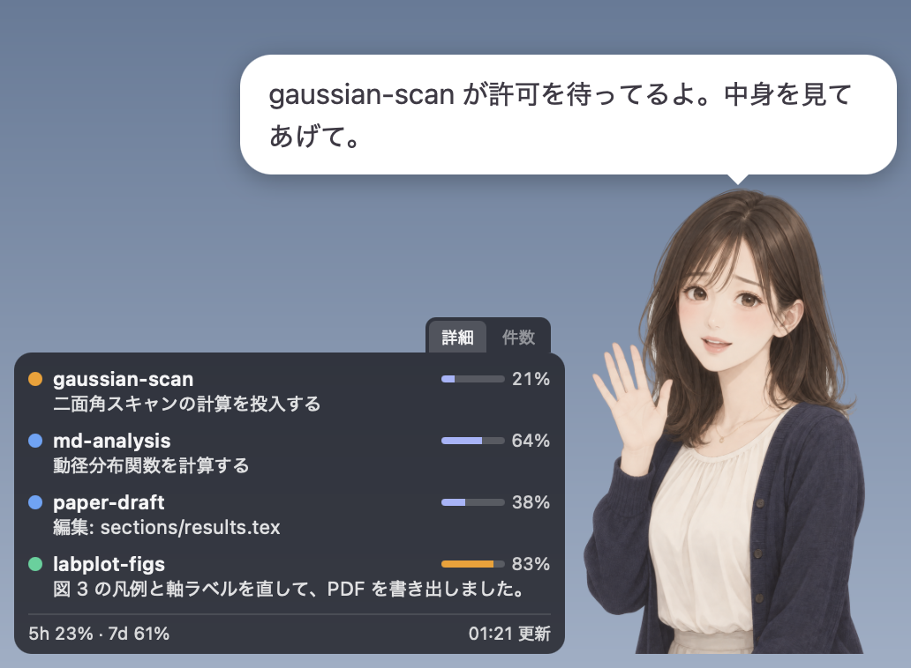

# marimo

marimo は、AI のコーディングエージェントのセッションの状態を画面の隅で知らせるデスクトップウィジェットです。対応しているのは、Claude Code、Codex、Hermes Agent、OpenCode の四つです。20 代半ばの女性、小春（こはる）の立ち絵がふんわりとしたイラストで画面の隅に立ち、各セッションが作業中なのか、承認を待っているのか、終わったのかを表情と吹き出しで伝えます。横に並ぶ小さなパネルには、セッションごとのコンテキスト使用率と、Claude Code と Codex のアカウント全体の利用制限も出ます。設定のウィンドウから、Claude Code のマスコットの Clawd のドット絵に切り替えることもできます。

<p align="center">
  
</p>

上の画面は、架空のセッションを四つ動かしたときの様子です。gaussian-scan がコマンドの実行許可を待っているので、立ち絵が手を振って吹き出しで知らせています。パネルには、承認待ち（橙）、作業中（青）、完了（緑）のセッションが 1 行ずつ並び、それぞれのコンテキスト使用率と今の作業の要約が出ています。いちばん下の行は、アカウント全体の利用制限です。

別の作業をしていても、エージェントのウィンドウを見に行かずに状況が分かるようにすることが marimo の目的です。marimo は、それぞれのツールが外部のプログラムへイベントを知らせるために用意している仕組みから状態を受け取ります。使う仕組みはツールごとに違い、次のとおりです。

- Claude Code からは、フック（hook。特定のイベントが起きたときに Claude Code が呼び出す外部コマンド）と statusLine（端末で動かすコマンドラインインターフェース、つまり CLI の画面下部に一行を表示するための外部コマンド）で受け取ります。
- Codex からは、フックで受け取ります。
- Hermes Agent からは、シェルフック（決まったイベントのたびに Hermes が呼び出す外部コマンド）で、`marimo-hook hermes-hook` が受け取ります。
- OpenCode からは、プラグイン（OpenCode の中で動いてイベントを受け取る JavaScript のファイル）で受け取ります。

ツールごとの違いは、[対応しているツール](#対応しているツール)に書いています。

> [!NOTE]
> marimo は有志が作った非公式のツールです。Anthropic をはじめ、marimo が対応しているツールのどの開発元とも関係がなく、どの開発元が承認したものでもありません。Claude と Claude Code は Anthropic の商標です。Codex、ChatGPT、Hermes Agent、OpenCode などのそのほかの製品名は、それぞれの会社の商標または登録商標である場合があります。

## ドキュメント

この README には、marimo が見せるもの、対応しているツール、動作環境、導入の手順をまとめています。詳しい説明は、次の三つの文書に分けています。

- [marimo の使い方](docs/usage.md) では、起動と終了、アイコンと右クリックメニュー、設定のウィンドウ、パネルの見方、セッションへの移動、立ち絵の表情、利用制限の表示、更新、困ったときの対処、アンインストールを説明しています。
- [見た目を変える](docs/customize.md) では、セリフの変え方、自分のキャラクターの作り方、素材の作り直し方を説明しています。
- [marimo の開発](docs/development.md) では、ソースからのビルド、`install` が書き換えるもの、ファイルとデータ、プライバシーとセキュリティ、テスト、アイコンの描き直し方、仕組みを説明しています。

## marimo が見せるもの

### 状態の種類と優先度

marimo は、どのツールのセッションも次の五つの状態に分けて扱います。表の「この状態になるトリガー」は、Claude Code のフックのイベント名で書いています。Codex のフックは同じ名前のイベントを送り、Hermes Agent と OpenCode のイベントは marimo がこれらのイベントに読み替えるので、どのツールでも同じ規則で状態が決まります（読み替え方は[対応しているツール](#対応しているツール)を参照）。

| 状態 | 意味 | この状態になるトリガー |
| --- | --- | --- |
| 承認待ち | エージェントが利用者の操作を待っています | ツールの実行許可の確認（PermissionRequest。サブエージェントからのものを含みます）、質問（AskUserQuestion）、計画の承認（ExitPlanMode）、入力の要求（Elicitation）、承認待ちの通知 |
| エラー | 応答が途中で失敗しました | StopFailure（利用制限に達したときなど） |
| 作業中 | エージェントが考えているか、ツールを使っているか、サブエージェントが動いています | プロンプトの送信、ツールの実行の前後、サブエージェントの開始（SubagentStart） |
| 完了 | 応答が終わり、動いているサブエージェントもありません | Stop、最後のサブエージェントの終了（SubagentStop） |
| 待機 | 何もしていません | セッションの開始。中断や承認の拒否で作業中や承認待ちのまま残ったセッションは、応答の終了から 60 秒ほどで届く待機の通知（idle_prompt）でも待機へ戻ります |

完了は「応答が終わった」ことだけを意味し、成功したとは限りません。完了の状態は、次のプロンプトを送るまで続きます。セッションが終わる（SessionEnd）と、marimo はそのセッションを一覧から消します。ただし、完了とエラーのセッションは、`/exit` や `/clear` のように利用者がその会話の画面で終わらせたとき以外は消さずに残します。Claude のデスクトップアプリは、メモリが足りなくなると何もしていないセッションをバックグラウンドで止めたり、会話をバックグラウンドで開き直したりするので、まだ読んでいない結果が知らせずに消えないようにするためです。OpenCode で会話を消したときは、消した会話は開き直せないので、完了とエラーの行も消します。残っている完了とエラーの行は、既読にするとパネルから折りたためます（[完了とエラーの既読](docs/usage.md#完了とエラーの既読)を参照）。

複数のセッションが同時に動いているとき、立ち絵の表情にはいちばん優先度の高い状態が出ます。優先度は高い順に、承認待ち、エラー、作業中、完了、待機です。完了を作業中より下に置いているのは、あるセッションの作業を見守っている間に、他のセッションが終わるたびに表情が切り替わらないようにするためです。完了したことはパネルの行の色で分かります。

### 立ち絵、吹き出し、パネルの役割

marimo のウィンドウは、立ち絵、吹き出し、パネルの三つでできています。

<p align="center">
  
</p>

- **立ち絵**は、全体の状態をひと目で伝えます。待機中と作業中は瞬きと呼吸のような小さな動きがあり、作業中は使っているツールによって顔が変わり、待機中はときどき仕草を見せます。表情の一覧と切り替わり方は、[立ち絵の表情](docs/usage.md#立ち絵の表情)に書いています。
- **吹き出し**は、承認待ち、完了、エラーになったときに立ち絵の頭の上に出て、どのリポジトリ（リポジトリの外では作業フォルダ）で何が起きたかをひとことで伝えます。セリフは状況に合わせて用意された候補から選ばれ、大規模言語モデル（LLM）は呼びません。
- **パネル**は、立ち絵の横の画面の内側の方に、待機以外のセッションを 1 セッション 1 行で並べます。各行には状態の色、どのツールのセッションかを示すアプリのアイコンか文字のマーク、リポジトリ名とチャットのタイトル、コンテキスト使用率、今何をしているかの短い要約、そして最後に動きがあってからの時間が出ます。パネルの下端には、Claude Code と Codex の利用制限が一行で出ます。

キャラクターは、既定の小春と Clawd から、設定のウィンドウで選べます（[設定](docs/usage.md#設定)を参照）。Clawd は Anthropic の Claude Code のマスコットです。marimo では、Claude Code の起動時に出るロゴと同じ形のドット絵で描いています。

## 対応しているツール

marimo が対応しているのは、Claude Code、Codex、Hermes Agent、OpenCode の四つです。どのツールのセッションも同じパネルに並び、立ち絵の表情と吹き出しにも同じように反映されます。どのツールのセッションかは、パネルの行のアイコンか文字のマークで見分けます（[パネルの見方](docs/usage.md#パネルの見方)を参照）。ツールごとに違うのは、状態を受け取る仕組みと登録のしかた、パネルに出せるもの、行を押したときの移動先です。この節では、まず違いを表にまとめ、そのあとでツールごとの制約を説明します。

### 情報源と登録のしかた

どのツールでも、状態を受け取って書き留めるのは同じコマンド `marimo-hook` で、ツールごとに違うサブコマンド（コマンドに続けて渡す、処理の種類を表す引数）で呼ばれます。

| ツール | 情報源 | 呼ばれるサブコマンド | 登録のしかた |
| --- | --- | --- | --- |
| Claude Code | フックと statusLine | `hook`、`statusline` | `marimo-hook install` が Claude Code の `settings.json` に登録します |
| Codex | フック | `codex-hook` | `install` が Codex の `hooks.json` に登録し、利用者が Codex CLI の `/hooks` で信頼します |
| Hermes Agent | シェルフック | `hermes-hook` | 利用者が Hermes の `config.yaml` に手で書き、Hermes で承認します |
| OpenCode | プラグイン | `opencode-hook` | `install` が OpenCode の設定のフォルダにプラグインのファイルを置き、利用者が OpenCode を起動し直します |

登録の手順は、[2. 各ツールに登録する](#2-各ツールに登録する)に書いています。

### パネルに出せるもの

| 項目 | Claude Code | Codex | Hermes Agent | OpenCode |
| --- | --- | --- | --- | --- |
| パネルのマーク | Claude のデスクトップアプリのアイコン。読めなければ `CC` | Codex のデスクトップアプリのアイコン。読めなければ `CX` | marimo に同梱した Hermes Agent のアイコン | OpenCode のデスクトップアプリのアイコン。読めなければ marimo に同梱した OpenCode のアイコン |
| タイトル | Claude Code が付けた会話のタイトル | Codex の会話のタイトル | Discord のチャンネル名か `DM` | OpenCode の会話のタイトル |
| コンテキスト使用率 | CLI ではパーセント。デスクトップアプリの Code タブではトークン数 | 上限が分かれば、Codex の画面と同じ式のパーセント | 上限が分かればパーセント、分からなければトークン数 | 上限が分かればパーセント、分からなければトークン数 |
| 利用制限 | 5 時間と 7 日 | Codex が送ってきたウィンドウ | 出ません | 出ません |
| 行を押したときの移動先 | 端末のタブ、エディタのウィンドウ、デスクトップアプリの会話 | Claude Code と同じ | Discord のチャンネル | macOS の Ghostty の端末だけ |
| サブエージェント | 動いている間は親の行が作業中のままです | 動いている間は親の行が作業中のままです | 親とは別の行になります | 行を作らず、親の行の作業として出します |

行を押したときの動きは[セッションへ移動する](docs/usage.md#セッションへ移動する)に、利用制限の出方は[利用制限の表示](docs/usage.md#利用制限の表示)に書いています。

### Claude Code

情報源は Claude Code のフックと statusLine です。フックから状態を、statusLine からコンテキスト使用率、タイトル、5 時間と 7 日の利用制限を受け取ります。Claude Code は 2.1.139 以降が必要です（[動作環境](#動作環境)を参照）。

statusLine は端末で動かす CLI でだけ呼ばれ、デスクトップアプリの Code タブでは呼ばれません。このため Code タブのセッションでは、コンテキスト使用率を会話ログから数えてトークン数で出し、利用制限は CLI も使っているときだけ出ます。クラウドで動くセッションと Cowork では、ローカルの設定のフックが動かないので表示できません。何をどう登録するかは、[フックと statusLine の登録](docs/development.md#フックと-statusline-の登録)に書いています。

### Codex

情報源は OpenAI の Codex CLI のフックで、Claude Code と同じ名前のイベントを受け取り、同じ規則で状態を決めます。Codex のフックは、利用者が Codex CLI の `/hooks` で信頼するまで動きません。Codex の利用制限は、Claude Code の利用制限と同じ行に並びます（[利用制限の行](docs/usage.md#利用制限の行)を参照）。

パネルに並べるのは、Codex のデスクトップアプリ、端末の Codex CLI、VS Code の拡張機能から自分で始めた会話だけです。Claude Code が作業を任せるためにバックグラウンドで動かした Codex の会話や `codex exec` の会話は並べません。Codex のフックから何を記録するかは、[Codex のフックから記録するもの](docs/development.md#codex-のフックから記録するもの)に書いています。

ChatGPT のエージェントの Dots がクラウドから動かす会話は、フックで記録できないので、手でインポートした一覧を試験的にパネルへ並べられます。設定のウィンドウの「表示」の見出しにある「Cloud の会話を表示（手動観測）」で切り替え、既定では表示しません。行の名前には「Cloud・手動」が付きます。インポートした状態が有効なのは観測から 2 分間で、それを過ぎた行は「状態不明」として薄く残ります。自動での取得と、トークン使用量の表示には対応していません。インポートのしかたは [Cloud の手動観測](docs/development.md#cloud-の手動観測)に書いています。

### Hermes Agent

情報源は Nous Research の Hermes Agent のシェルフックで、`marimo-hook hermes-hook` が Hermes のイベントとツールを Claude Code のものに読み替え、同じ規則で状態を決めます。Hermes のフックは `install` では登録しないので、[Hermes のフック](docs/development.md#hermes-のフック)の手順で手で登録します。

Discord などのチャットから使う gateway（Hermes をチャットにつないで常駐させる部分）のセッションは、行の名前にチャンネル名（DM では `DM`）が出て、行を押すと Discord のそのチャンネルが開きます。CLI の会話のように開く先が分からないセッションでは、行を押しても既読になるだけです。パネルのマークには、Hermes Agent が MIT ライセンスで配っているアイコンを marimo に同梱して使います。Hermes のフックの入力には利用制限の値が無いので、利用制限は出ません。何を記録するかは、[Hermes のフックから記録するもの](docs/development.md#hermes-のフックから記録するもの)に書いています。

### OpenCode

対象は OpenCode v2 を端末から使うときのセッションです。OpenCode v2 の端末の画面（TUI。端末の中に描かれる操作画面）は、会話を動かすサービスにつながって動きます。つながる先は、既定ではバックグラウンドのサービスで、`--standalone` を付けて起動したときはその端末専用のサーバー、`opencode serve` で起動したサーバーを指定したときはそのサーバーです。marimo のプラグインはこのサービスの中で動き、セッションのイベントを `marimo-hook opencode-hook` に渡します。`opencode-hook` は、それを Claude Code のイベントに読み替えてから同じ規則で状態を決めます。v1 のデスクトップアプリには対応していません。

`marimo-hook install` は、OpenCode の設定のフォルダ（`~/.config/opencode`。環境変数 `XDG_CONFIG_HOME` を設定していれば、その下の `opencode`）があるときだけ、その中の `plugins/marimo.js` にプラグインを置きます。OpenCode の設定ファイルは書き換えません。OpenCode はプラグインを起動したときにだけ読むので、置いたあとに、動いている OpenCode をバックグラウンドのサービスも含めて起動し直します。`uninstall` はこのファイルを消します。同じ名前のファイルが marimo の書いたものでなければ、`install` も `uninstall` もそのファイルに触れません。

状態は次のように決まります。ターンが始まると作業中になり、ツールの実行許可を求めている間と、質問のフォームへの答えを待っている間は承認待ちになります。ターンが終わると完了に、ターンが失敗するとエラーになります。途中の一歩が失敗しても、OpenCode が再試行する間はエラーにしません。利用者がターンを中断したときや、サービスが終わってターンが止まったときは待機へ戻ります。OpenCode のサブエージェントは親を持つ別のセッションとして動きますが、marimo はその行を作らず、親の行をサブエージェントのツールを使っている作業中として出します。サブエージェントが実行許可や質問の答えを待っている間は、親の行を承認待ちとして出します。

行を押すと、macOS の Ghostty の中で動いている OpenCode の端末の画面を探します。OpenCode の端末の画面は端末のタイトルを `OC | タイトル` の形にするので、そのタイトルの端末を探し、見つからなければ作業フォルダが一致する端末が一つだけのときにそれを前面に出します。どちらでも見つからなければ何もしません。Terminal.app、iTerm2、Windows の端末では移動しません。会話を動かすサービスは端末とは別のプロセスなので、どの端末から始めた会話かを記録できないためです。

パネルのマークは、macOS で OpenCode のデスクトップアプリが入っていればそのアイコンで、そうでなければ OpenCode が MIT ライセンスで配っているアイコンを marimo に同梱したものです。コンテキスト使用率は、モデルの呼び出しの一歩が終わるたびに、その一歩のトークン数から出します。モデルの上限が OpenCode のモデルの一覧から分かればパーセントで、分からなければトークン数で出します。利用制限は出ません。何を記録するかは、[OpenCode のプラグインから記録するもの](docs/development.md#opencode-のプラグインから記録するもの)に書いています。

## 動作環境

marimo は macOS で動作を確かめており、Windows 11 でも大半の機能を確かめています。どのツールを、そのツールのどの画面から使うかによって、使える機能が変わります。

Claude Code は 2.1.139 以降が必要です。marimo は、このバージョンで加わった exec form という書き方でフックを登録するためです。OpenCode は v2 が必要です。

| ツール | 使い方 | 確認の状況 | 使える機能 |
| --- | --- | --- | --- |
| Claude Code | macOS の端末で動かす CLI | 確認済み | すべての機能が使えます。フックと statusLine の両方が動きます。更新用のスクリプトでローカルでビルドして更新する方法も確かめています。行を押してセッションへ移動する機能は Terminal.app と Ghostty で確かめており、Ghostty では Claude Code の background session からも移れることを確かめています。iTerm2 と VS Code の統合ターミナルでの見分け方は、それぞれのアプリの文書に基づいています |
| Claude Code | macOS のデスクトップアプリの Code タブ | 確認済み | フックは承認待ちを含めて届きます。statusLine はこの画面では呼ばれないので、利用制限は CLI も使っているときだけ出ます。そのときは、CLI の statusLine が最後に届けた値を出します（[利用制限の表示](docs/usage.md#利用制限の表示)を参照） |
| Claude Code | VS Code の拡張機能の画面 | 未確認 | statusLine が動くかどうかを確かめていません |
| Claude Code | Windows | 一部確認済み | Windows 11 で、ビルド、NSIS（Windows 向けのインストーラを作る仕組み）のインストーラによる導入、更新用のスクリプトでローカルでビルドする更新、`install`、フックの発火、自動起動、クリック透過、通知領域のアイコンからウィンドウを隠して出し直す操作を確かめています。statusLine が無い場合の `install` による登録が Git Bash と PowerShell のどちらでも動くことと、既存の statusLine を `install` がラップしても元の表示が変わらず、CLI のセッションでコンテキスト使用率がパーセントで出ることも確かめています（[statusLine のラップのしかた](docs/development.md#statusline-のラップのしかた)を参照）。ラップできない statusLine を使っている場合は、marimo が statusLine を受け取れないので、Claude Code の利用制限は出ません。行を押してセッションへ移動する機能は、デスクトップアプリの Code タブ、Windows Terminal、conhost、VS Code の統合ターミナルのどれでも確かめています（[セッションへ移動する](docs/usage.md#セッションへ移動する)を参照） |
| Claude Code | Linux | 未確認 | 動作を確かめていません |
| Claude Code | クラウドで動くセッション（スマートフォンの Code タブなど） | 対象外 | ローカルの `~/.claude/settings.json` を読まないので、フックが届きません |
| Claude Code | Cowork | 対象外 | settings.json のフックが発火しないという報告があります |
| Codex | macOS のデスクトップアプリ | 確認済み | `/hooks` で信頼したフックが届き、作業中、`request_permissions` による承認待ち、完了、タイトル、コンテキスト使用率がパネルに出ることと、行を押すとデスクトップアプリが前面に出ること、利用制限が `codex_rate_limits.json` に記録されることを確かめています（[Codex](#codex)を参照） |
| Codex | macOS の端末で動かす Codex CLI | 確認済み | Terminal.app で、フックが届いて作業中と承認待ちが出ることと、行を押すと端末が前面に出ることを確かめています |
| Codex | Windows の Codex CLI | 一部確認済み | 実行ファイルのパスが条件を満たす場合だけフックを登録します（[Codex のフック](docs/development.md#codex-のフック)を参照）。Codex のフックが届いてパネルの行が動くことと、アプリのアイコンが出ることを確かめています |
| Hermes Agent | Windows の Discord の gateway | 一部確認済み | 手で登録したフックが gateway に読み込まれ、Discord のチャンネルでの会話が、チャンネル名の行として作業中から完了へ動くことと、応答の後に Hermes がバックグラウンドで走らせる見直しで完了の行が作業中へ戻らないことを確かめています。行を押すと Discord のそのチャンネルが開き、Discord のウィンドウが前面に出ることも確かめています。承認待ち、エラー、CLI の会話は確かめていません（[Hermes Agent](#hermes-agent)を参照） |
| OpenCode | macOS の端末で動かす v2 | 一部確認済み | `opencode run --standalone` で、作業中から完了、許可待ちから作業中、質問待ちから作業中へ移ることと、サブエージェントが行を作らないこと、タイトルとコンテキスト使用率が出ることを確かめています。TUI とバックグラウンドのサービスの下でも、行が出て作業中、許可待ち、完了と動くことと、行を押すと Ghostty の端末へ移れること、中断で待機に戻ることと、エラーが出ることを確かめています。行を押したときに移動できるのは Ghostty の端末だけです（[OpenCode](#opencode)を参照） |
| OpenCode | Windows の端末で動かす v2 の TUI | 未確認 | プラグインは、ほかの OS と同じくホームの `.config/opencode` の下に置きます。行を押しても移動せず、パネルのマークは marimo に同梱した OpenCode のアイコンです |
| OpenCode | v1 のデスクトップアプリ | 対象外 | marimo のプラグインは v2 のプラグインの仕組みで書いているので、v1 では読み込まれません |

## インストール

インストールは四つの段階に分かれています。1. から 3. は最初に一度だけ行い、そのあと繰り返し必要なのはアプリの起動だけです。新しいバージョンへ更新するときは、[4. 更新する](#4-更新する)のスクリプトを使うと、GitHub Actions の CI（継続的インテグレーション。push のたびに自動でテストやビルドを行う仕組み）がビルドしたものを取ってきて、起動し直すまでを一つのコマンドで済ませられます。ここからのコマンドは、リポジトリの直下で実行します。

### 1. ビルドする

最初の導入では、リポジトリを clone したら自分でビルドします。必要なツールとそのバージョンは、[必要なもの](docs/development.md#必要なもの)に書いています。導入したあとの更新では、CI がビルドしたものを更新用のスクリプトが取ってくるので、ローカルでのビルドは要りません。

まず、各ツールから呼ばれるコマンド `marimo-hook` をビルドします。

```bash
cargo build --release -p marimo-hook
```

次に、`app/` へ移動して画面部分の依存をインストールし、Tauri でアプリをまとめます。`npm run tauri -- build` は、画面部分のビルド（`npm run build`）と Rust 側のビルドをまとめて実行します。最後の `cd ..` で、リポジトリの直下へ戻ります。

```bash
cd app
npm install
npm run tauri -- build
cd ..
```

できあがるものの場所は[ビルドの成果物](docs/development.md#ビルドの成果物)に書いています。

### 2. 各ツールに登録する

各ツールへの登録は、`marimo-hook install` を利用者が端末で実行して行います。`install` は、Claude Code のフックと statusLine を登録し、Codex のフォルダがあれば Codex のフックを、OpenCode の設定のフォルダがあれば OpenCode のプラグインを登録します。Hermes Agent だけは `install` では登録しません。この手順は Claude Code 自身の設定ファイル `~/.claude/settings.json` を書き換えるので、Claude Code に頼まずに自分で実行してください。Claude Code は権限の設定によっては自分の設定ファイルの書き換えを拒みますし、何が変わるのかを自分の目で確かめておくと安心です。

最初に `--dry-run` を付けて実行すると、ファイルを書き換えずに、変更後の settings.json と変更点だけを表示します。

```bash
./target/release/marimo-hook install --dry-run
```

内容に問題がなければ、`--dry-run` を外して実行します。

```bash
./target/release/marimo-hook install
```

`install` は書き換える前に settings.json のバックアップを取り、既存のフックや設定はそのまま残します。何をどう書き換えるかは、[フックと statusLine の登録](docs/development.md#フックと-statusline-の登録)に書いています。

`install` のあとに、使っているツールごとに次のことを行います。

| ツール | `install` のあとに行うこと |
| --- | --- |
| Claude Code | 行うことはありません。登録より前から開いていたセッションで状態が出ないときは、そのセッションを開き直します |
| Codex | Codex CLI で `/hooks` を開き、marimo のフックを信頼します（[Codex のフック](docs/development.md#codex-のフック)を参照） |
| Hermes Agent | Hermes の `config.yaml` へ手でフックを加え、Hermes で承認してから gateway を起動し直します（[Hermes のフック](docs/development.md#hermes-のフック)を参照） |
| OpenCode | 動いている OpenCode を、バックグラウンドのサービスも含めて起動し直します。サービスは `opencode service restart` で起動し直せます（[OpenCode のプラグイン](docs/development.md#opencode-のプラグイン)を参照） |

### 3. アプリを置いて起動する

macOS では、`marimo.app` を `/Applications` へコピーします。

```bash
cp -R target/release/bundle/macos/marimo.app /Applications/
```

Finder から開くか、次のコマンドで起動します。初めて開くときに macOS が「開けません」と警告した場合の開き方は、[ad-hoc 署名について](docs/development.md#ad-hoc-署名について)に書いています。

```bash
open /Applications/marimo.app
```

Windows では、NSIS のインストーラで入れます。利用者ごとのインストールなので、管理者の権限は要りません。

```powershell
.\target\release\bundle\nsis\marimo_0.1.0_x64-setup.exe
```

`%LOCALAPPDATA%\marimo\marimo.exe` に入り、スタートメニューにショートカットができるので、そこから起動します。

起動すると、画面の右下に立ち絵が現れ、macOS ではメニューバーに、Windows では通知領域にアイコンが出ます（[marimo の使い方](docs/usage.md#起動と終了)を参照）。ログインのたびに起動したいときは、右クリックメニューの「設定…」で開く設定のウィンドウで、「ログイン時に起動」にチェックを入れます（[ログイン時に起動する](docs/usage.md#ログイン時に起動する)を参照）。

### 4. 更新する

新しいバージョンへ更新するときは、`cp` で上書きせずに、リポジトリに入っている更新用のスクリプトを使います。スクリプトは GitHub に公開された最新の正式なリリースを取ってきて、取ってきたリリースの名前を表示してから入れ替えます。スクリプトは自分の置き場所からリポジトリを見つけるので、どのフォルダから実行してもかまいません。ここではリポジトリの直下で実行します。macOS では次のコマンドを実行します。

```bash
tools/update.sh
```

Windows では、PowerShell 7 で次のコマンドを実行します。スクリプトの実行が既定で禁じられている環境でも動くよう、このコマンドの間だけ実行ポリシーを緩めて起動します。PowerShell 7 が入っていないときは、`pwsh` を Windows に最初から入っている Windows PowerShell 5.1 の `powershell` に置き換えても動きます。

```powershell
pwsh -ExecutionPolicy Bypass -File .\tools\update.ps1
```

公開されているプレリリースを入れるときは、macOS では `--pre` を、Windows では `-Pre` を付けます。設定のウィンドウからの更新はプレリリースを選ばないので、プレリリースはこの方法でだけ入ります。正式なリリースより新しい main の最新を入れるときは、macOS では `--main` を、Windows では `-Main` を付けます。スクリプトは main の最新を pull し、CI がそのコミットについてビルドしたものを取ってきます。push した直後で CI のビルドがまだできていないときは、スクリプトは何も変えずに終わります。macOS では `--main --wait` を、Windows では `-Main -Wait` を付けると、ビルドができあがるまで最大 30 分待ちます。ネットワークにつながらないときや、main 以外のブランチを試すときは、macOS では `--build` を、Windows では `-Build` を付けてローカルでビルドします。スクリプトが行うことと、失敗したときの動きは[更新する](docs/usage.md#更新する)に書いています。marimo を取り除くときは、[アンインストール](docs/usage.md#アンインストール)の手順に従ってください。

## 不具合の報告と貢献

不具合の報告や改善の提案は、GitHub の Issue で受け付けています。再現の手順と、OS（macOS か Windows）とそのバージョン、Claude Code、Codex、Hermes Agent、OpenCode のどれで起きたかとそのバージョン、そのツールを端末とデスクトップアプリのどちらで使っているかを添えてもらえると助かります。状態ファイルや会話ログを添えるときは、作業フォルダ名やコマンドに人に見せたくない情報が入っていないかを先に確かめてください。

settings.json の書き換え、OpenCode のプラグインの配置、会話ログの読み取りなど、安全に関わる問題を見つけた場合は、公開の Issue ではなく、GitHub の Security Advisories から非公開で報告してください。

プルリクエストを送るときは、[テストと検査](docs/development.md#テストと検査)のコマンドがすべて通ることを確かめてください。挙動を変える変更には、その挙動を確かめるテストを付けてください。

## ライセンス

コードは、[MIT License](LICENSE-MIT) と [Apache License 2.0](LICENSE-APACHE) のどちらかを、利用する人が選んで使えます。

立ち絵などの画像とセリフは、[クリエイティブ・コモンズ 表示 4.0 国際ライセンス（CC BY 4.0）](https://creativecommons.org/licenses/by/4.0/deed.ja)で公開しています。対象は `assets/`（`assets/character/clawd/` を除きます）、`art/`、`docs/images/`、`app/src-tauri/icons/`、`app/src-tauri/shipped-dialogue/` です。詳しくは [LICENSE-ASSETS](LICENSE-ASSETS) を見てください。

小春の立ち絵は OpenAI の画像生成モデルで作った画像を元に、`tools/character/build.py` で顔の差分の合成と背景の除去をして仕上げています。`art/` の元の画像には、生成したサービスが埋め込んだメタデータがそのまま残っています。

`assets/character/clawd/` の Clawd のドット絵は、Anthropic の Claude Code のマスコットを非公式に描いたファンアートで、Claude Code の起動時のロゴの形に従って `tools/character/clawd.py` が描いています。このフォルダは CC BY 4.0 の対象に含めません。marimo は Anthropic の意匠や商標についての権利を何も与えず、この絵は Anthropic による承認や提携を意味しません。`tools/character/clawd.py` そのものはコードなので、ほかのコードと同じライセンスで使えます。

メニューバーと通知領域のアイコンは `tools/tray_icon.py` が、アプリのアイコンは `tools/app_icon.py` が描いた、marimo 独自のまりもの絵です。
