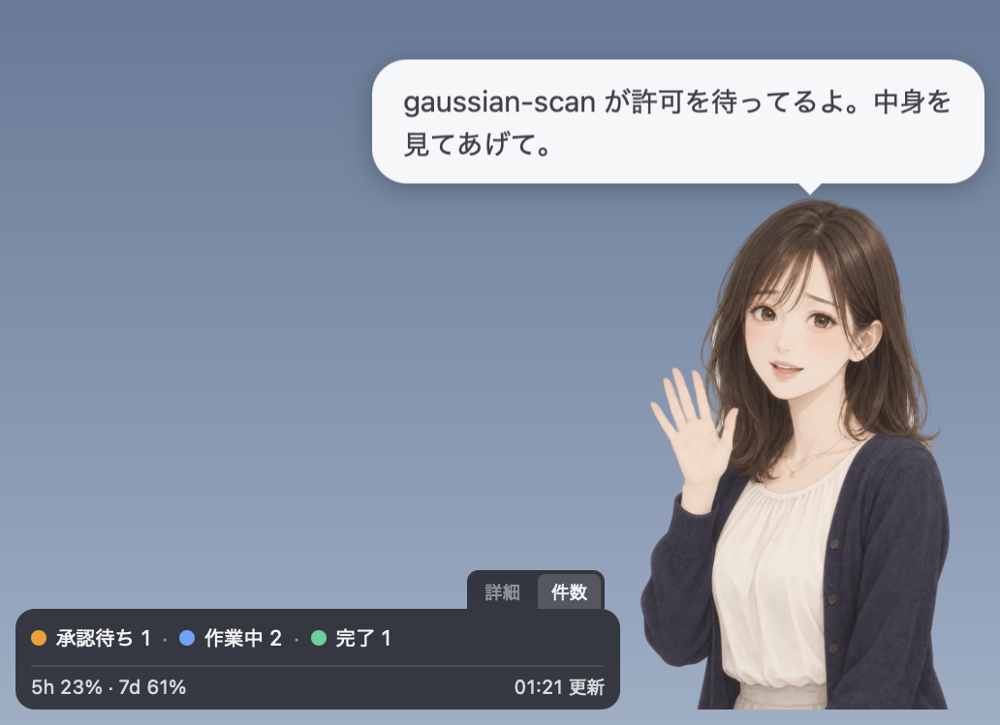

# marimo の使い方

[English](usage.md) | 日本語

marimo を導入したあとの日常的な利用方法を記載しています。導入の手順は [README](../README.ja.md#インストール) を参照してください。

- [起動と終了](#起動と終了)
- [ログイン時に起動する](#ログイン時に起動する)
- [メニューバーと通知領域のアイコン](#メニューバーと通知領域のアイコン)
- [右クリックメニュー](#右クリックメニュー)
- [設定](#設定)
- [表示を切り替える](#表示を切り替える)
- [パネルの見方](#パネルの見方)
- [セッションへ移動する](#セッションへ移動する)
- [完了とエラーの既読](#完了とエラーの既読)
- [吹き出し](#吹き出し)
- [立ち絵の表情](#立ち絵の表情)
- [立ち絵への操作](#立ち絵への操作)
- [利用制限の表示](#利用制限の表示)
- [更新する](#更新する)
- [困ったとき](#困ったとき)
- [アンインストール](#アンインストール)

## 起動と終了

起動すると、画面の右下に立ち絵が表示され、macOS ではメニューバーに、Windows では通知領域にまりもの形のアイコンが表示されます（[メニューバーと通知領域のアイコン](#メニューバーと通知領域のアイコン)を参照）。macOS では Dock とアプリの切り替え（Cmd+Tab）に、Windows ではタスクバーに表示されません。ウィンドウは常に他のウィンドウより手前に表示されます。起動中にもう一度起動すると、二つ目は何もせずに終了し、アイコンから隠していたウィンドウがあれば再表示します。

終了するときは、右クリックメニューか、アイコンのメニューの「終了」を選択します。

## ログイン時に起動する

macOS では `/Applications` に置いた `marimo.app` を、Windows ではインストーラで導入した `%LOCALAPPDATA%\marimo\marimo.exe` を起動し、[設定](#設定)のウィンドウの「起動」で「ログイン時に起動」にチェックを入れます。既定は無効です。

有効にすると、macOS では `~/Library/LaunchAgents/com.marimo.desktop.plist` に LaunchAgent（ログイン時に macOS がプログラムを起動するための設定ファイル）を作成し、Windows ではレジストリの `HKEY_CURRENT_USER\Software\Microsoft\Windows\CurrentVersion\Run` に登録します。どちらも、有効にした時点で動作している実行ファイルのパスを指します。

自動起動が有効なまま marimo を起動すると、その実行ファイルのパスで登録し直します。`marimo.app` を別の場所へ移した場合や、`target\release\marimo.exe` から起動したまま有効にしていた場合も、インストールした marimo を一度起動すれば、次回のログインからはそちらが起動します。ソースツリーの `target` から起動したときは、試しに動かしただけで登録が書き換わらないよう、登録し直しません。

## メニューバーと通知領域のアイコン

marimo は、macOS ではメニューバーに、Windows では通知領域に、まりもの形のアイコンを表示します。アイコンを左クリックすると立ち絵とパネルのウィンドウを隠し、もう一度押すと再表示します。隠している間も状態の記録は続き、再表示したときには現在の状態が表示されます。macOS では、再表示しても使用中のアプリからキーボードの入力先を奪いません。隠した状態は保存しないため、marimo を再起動するとウィンドウが表示された状態から始まります。

アイコンを右クリックすると、以下のメニューが表示されます。対応が必要なセッションがあるときは、その一覧がメニューの最上部に並び、区切り線を挟んで表の項目が続きます。

| 項目 | 働き |
| --- | --- |
| 承認待ち、エラー、完了のセッション | 承認待ちのセッションと、未読のエラーと完了のセッションを、この順に、同じ状態の中では更新の新しい順に並べます。項目には、状態、パネルと同じ名前、分かっていれば会話のタイトル（長いときは省略）が表示されます。選択すると、パネルでそのセッションを押したときと同じく、セッションへ移動して既読にします（[セッションへ移動する](#セッションへ移動する)を参照）。該当するセッションが無いときは、一覧も区切り線も表示しません |
| ほか N 件 | 一覧は 10 件までで、それより多いときに並べなかった件数を示します。選択できません |
| marimo を隠す、marimo を表示 | ウィンドウを隠すか再表示します。現在の状態に合わせて、どちらか一方が表示されます |
| 位置をリセット | 保存したウィンドウの位置を削除し、主モニタの右下（既定の位置）へ戻します。ウィンドウが隠れていれば再表示します |
| 立ち絵を表示 | 立ち絵と吹き出しを表示するかを切り替えます（[表示を切り替える](#表示を切り替える)を参照） |
| 詳細を表示、件数だけ表示 | パネルの表示方法を切り替えます（[表示を切り替える](#表示を切り替える)を参照） |
| 並べ方 | 「開始順」「状態順」「更新順」のサブメニューから、パネルのセッションの並べ方を選択します（[セッションの並べ方](#セッションの並べ方)を参照） |
| すべて既読にする | 未読の完了とエラーのセッションを、すべて既読にします。該当するセッションが無いときは選択できません（[完了とエラーの既読](#完了とエラーの既読)を参照） |
| X に更新できます | 新しい正式なバージョンがあるときのみ表示されます。選択すると、設定のウィンドウを「更新」の項目で開きます（[更新を確認する](#更新を確認する)を参照） |
| 設定… | 設定のウィンドウを開きます（[設定](#設定)を参照） |
| 終了 | marimo を終了します |

アイコンは、対応が必要なセッションがあるときのみ色が付きます。承認待ちとエラーが両方あるときは、立ち絵の表情と同じ優先度で承認待ちのアイコンになります。既読にしたエラーは、パネルと同じくアイコンにも反映しません。

| アイコン | 状態 |
| --- | --- |
| 緑のまりもにオレンジの「！」 | 承認待ちのセッションがある |
| 緑のまりもに赤の「！」 | 承認待ちは無く、エラーのセッションがある |
| macOS では黒一色、Windows では緑のまりも | どちらも無い |

ウィンドウを隠している間も、アイコンとメニューのセッションの一覧は状態に合わせて更新されるため、隠したままでも状態の変化に気付き、そのセッションへ移動できます。Windows では、アイコンが通知領域の隠れた部分（タスクバーの `^` を押すと表示される場所）に入ることがあります。

## 右クリックメニュー

立ち絵やパネルの上で右クリックすると、アイコンのメニューから、セッションの一覧、「ほか N 件」、「marimo を隠す」と「marimo を表示」、「位置をリセット」を除いた項目が表示されます。各項目の働きは[メニューバーと通知領域のアイコン](#メニューバーと通知領域のアイコン)の表と同じです。

パネルのセッションの上で右クリックしたときは、先頭にそのセッション向けの項目（「既読にする」（未読の完了・エラーのみ）、「作業フォルダのパスをコピー」（作業フォルダが分かるときのみ）、「このセッションを一覧から消す」）が表示されます。利用制限の欄の上で右クリックしたときは、先頭に「利用制限を今すぐ再取得」が表示されます。そのほかの設定は[設定](#設定)のウィンドウにあります。

## 設定

右クリックメニューか、アイコンのメニューの「設定…」を選択すると、「marimo の設定」というウィンドウが開きます。すでに開いているときは前面に表示されます。このウィンドウは枠の付いた通常のウィンドウで、閉じるボタンか Esc キーで閉じます。ウィンドウで変更した設定はその場で立ち絵とパネルに反映され、保存されて次回の起動でも使用されます（保存先は[ファイルとデータ](development.ja.md#ファイルとデータ)を参照）。ウィンドウを開いている間にメニューやパネルのボタンで表示を変更した場合も、ウィンドウの表示が追従します。

ウィンドウの左に「表示」「吹き出し」「キャラクター」「利用制限」「ショートカット」「起動」「更新」「言語」の八つの項目が並び、選択した項目の設定が右に表示されます。開いたときは「表示」が選択されています。

| 項目 | 設定 | 働き |
| --- | --- | --- |
| 表示 | 立ち絵を表示 | 立ち絵と吹き出しを表示するかを切り替えます（[表示を切り替える](#表示を切り替える)を参照） |
| 表示 | パネル | パネルの表示方法を「詳細」と「件数」から選択します（[表示を切り替える](#表示を切り替える)を参照） |
| 表示 | 並べ方 | パネルのセッションの並べ方を「開始順」「状態順」「更新順」から選択します（[セッションの並べ方](#セッションの並べ方)を参照） |
| 表示 | 背景の不透明度 | パネルの背景の濃さをスライダーで変更します（[背景の不透明度](#背景の不透明度)を参照） |
| 表示 | ウィンドウの位置 | 「既定の位置に戻す」を押すと、ウィンドウを主モニタの右下へ戻します |
| 吹き出し | 承認待ち、完了、エラー、表示時間 | 吹き出しを表示する種類と、自動で閉じるまでの時間を選択します（[吹き出し](#吹き出し)を参照） |
| キャラクター | キャラクター | 立ち絵のキャラクターを選択します。選択するとその場で切り替わります。切り替えに失敗したときは、変更前のキャラクターのままです |
| キャラクター | 大きさ | 立ち絵の大きさをスライダーで変更します（[大きさ](#大きさ)を参照） |
| 利用制限 | Claude Code、Codex、Antigravity | 利用制限の欄に値を表示するツールを選択します。既定はすべて表示します。チェックを外したツールには、利用制限を再取得させません。横には最終更新時刻や取得失敗の理由を表示します（[利用制限の表示](#利用制限の表示)を参照） |
| 利用制限 | 再取得の間隔、今すぐ再取得 | チェックしたツールに利用制限を再取得させる間隔を、「しない」「5 分ごと」「10 分ごと」「15 分ごと」「30 分ごと」「60 分ごと」から選択します。既定は「しない」です。「今すぐ再取得」を押すと、間隔によらず即座に再取得します（[利用制限の表示](#利用制限の表示)を参照） |
| ショートカット | 要対応のセッションへ移動、marimo の表示と非表示を切り替え | 他のアプリを操作しているときにも使える任意のグローバルショートカットを割り当てます。既定はどちらも未設定です。枠を押して、Ctrl、Alt、Cmd（Windows キー）のいずれかを含む組み合わせを入力すると登録され、「クリア」または Backspace / Delete で解除します。Esc で入力を取りやめます。Shift だけの組み合わせは、ほかのアプリでその文字を打てなくなるため登録できません |
| 起動 | ログイン時に起動 | ログイン時の自動起動を切り替えます。既定は無効です（[ログイン時に起動する](#ログイン時に起動する)を参照） |
| 更新 | 現在のバージョン、最新のリリース、確認した時刻 | 動作中の marimo のバージョンと、最後に確認した最新の正式なリリースを表示し、新しいバージョンがあれば更新します。「変更内容を見る」から GitHub のリリースページを開けます（[更新を確認する](#更新を確認する)を参照） |
| 言語 | 日本語、English | 画面の言語を「日本語」と「English」から選択します。選択するまでは OS の言語に従います（[言語](#言語)を参照） |

### 言語

言語を選択するまでは、OS の言語が日本語なら日本語で、それ以外なら英語で表示し、「言語」には表示中の言語が選ばれています。OS の言語は、macOS ではシステム設定の「言語と地域」で優先する言語の先頭、Windows では表示言語です。「日本語」か「English」を選択すると、OS の言語によらずその言語になります。選択はその場で反映され、`display.json` の `language` に保存されます（[ファイルとデータ](development.ja.md#ファイルとデータ)を参照）。OS の言語に従う状態へ戻すときは、marimo を終了してから `display.json` の `language` を削除し、marimo を起動します。

選択した言語は、以下に使用されます。

- 立ち絵、パネル、吹き出し、右クリックメニュー、アイコンのメニュー、設定のウィンドウの文言
- 吹き出しの既定のセリフ（[セリフを変える](customize.ja.md#セリフを変える)を参照）
- パネルの 2 段目の作業の要約。要約はフックが状態ファイルに書き込むときの言語で作成されるため、言語を変える前に書き込まれた要約は、そのセッションに次のフックが届くまで前の言語のまま表示されます。
- `marimo-hook install` と `uninstall` の出力と、更新用のスクリプトの出力

言語を選択する前に OS の言語を変えた場合、marimo の画面は次の起動から新しい言語になります。フック、`marimo-hook`、更新用のスクリプトは、実行のたびに OS の言語を読みます。

### 更新を確認する

marimo は、起動の 3 秒後と、その後 1 日ごとに、GitHub に新しい正式なバージョンがあるかを確認します。新しいバージョンがあるときは、アイコンのメニューの「設定…」の上に「0.1.7 に更新できます」のような項目が表示され、設定のウィンドウの左の一覧の「更新」の下にも同じ文が表示されます。確認に失敗したときは、アイコンのメニューには何も表示せず、設定のウィンドウの「更新」に理由を表示します。

設定のウィンドウの「更新」には、現在のバージョン、最新のリリース、最後に確認した時刻が表示されます。「更新を確認」を押すと、その場で再確認します。新しいバージョンがあるときのみ「0.1.7 に更新」のようなボタンが表示され、押すと確認のダイアログが表示されます。ダイアログで「更新」を押すと更新が始まり、進捗はボタンの下に表示されます。更新が終わると marimo が新しいバージョンで再起動します。ダイアログを表示したあとにさらに新しい正式なリリースが公開されていたときは、更新せずに再確認を求めます。失敗した場合は、理由がボタンの下に表示されます。この更新の動作は[設定のウィンドウから更新する](#設定のウィンドウから更新する)に記載しています。

### 背景の不透明度

「背景の不透明度」のスライダーで、パネルの背景の濃さを 20% から 100% までの間で 5% 刻みに変更できます。既定は 80% です。スライダーを動かしている間もパネルの背景がその場で変わり、スライダーの右に現在の値が「80%」のように表示されます。値は、スライダーからマウスのボタンを離したときに保存されます。

薄くなるのはパネルとその上辺のボタンの列の背景のみで、文字、アイコン、状態の色の点は薄くなりません。件数の欄にマウスを載せたときに重なって表示される詳細も一緒に薄くなりますが、下にある件数の欄やボタンの文字と混ざって読めなくならないよう、パネルより濃く保ちます。パネルが 80% 以上のときは不透明で、最も薄くしても 85% までです。吹き出しの濃さは変わりません。

### 大きさ

「大きさ」のスライダーで、立ち絵の倍率を 0.6 倍から 4.0 倍までの間で 0.1 刻みに変更できます。既定は 1.0 倍で、スライダーの右に現在の倍率が「1.0 倍」のように表示されます。立ち絵の上で Cmd キー（macOS 以外では Ctrl キー）を押しながらマウスのホイールを回しても、同じ範囲を 0.1 刻みで変更できます。倍率 1.0 のときの立ち絵の領域の大きさは、[自分のキャラクターを作る](customize.ja.md#自分のキャラクターを作る)に記載しています。

大きさを変えても、立ち絵のある隅のウィンドウの角は動かず、画面からはみ出す分は画面の内側へ戻ります。パネルと吹き出しの文字の大きさは変わりません。

## 表示を切り替える

「立ち絵を表示」と、パネルの「詳細を表示」「件数だけ表示」は、それぞれ独立に選択できます。既定は、立ち絵を表示したうえでの詳細の表示です。パネルはどの組み合わせでも表示されます。

これらと「並べ方」は、右クリックメニュー、アイコンのメニュー、設定のウィンドウの「表示」のいずれからも変更でき、どこで変更しても同じ設定が保存されます。どのメニューを開いても現在の状態にチェックが付き、設定のウィンドウも現在の状態を表示します。アイコンのメニューで選択した内容はアプリがその場で反映して保存するため、起動直後に選択した場合や、続けて素早く選択した場合も失われません。詳細と件数は立ち絵を押しても、並べ方はパネルの左上のボタンでも切り替えられます（[セッションの並べ方](#セッションの並べ方)を参照）。

詳細の表示にはファイル名やコマンドの一部が表示されるため、画面を人に見せるときは「件数だけ表示」へ切り替えてください。件数の欄にはファイル名もコマンドも表示されず、マウスを載せたときのみ詳細が重なって表示されます。ウィンドウごと見えなくするときは、メニューバーのアイコンを押して隠します。

「立ち絵を表示」を外すと、立ち絵と吹き出しが表示されなくなり、ウィンドウはパネルの幅へ詰まって画面の左右どちらの端にも寄せられます。パネルの余白や上辺右側の掴みしろをドラッグするとウィンドウを移動でき、パネル上で右クリックするとメニューが開きます。立ち絵が隠れている間は吹き出しを表示せず、「立ち絵を表示」を戻したときに吹き出しの対象の状態が続いていれば表示します。立ち絵の上でホイールを回す操作は使えないため、大きさは設定のウィンドウの「大きさ」で変更してください。

## パネルの見方

**詳細**の表示では、待機以外のセッションを 1 件ずつ並べます。既定では、始まった順に新しいセッションほど上に表示します（[セッションの並べ方](#セッションの並べ方)を参照）。各セッションは 2 段で表示されます。

- **1 段目** 状態の色の点、名前、チャットのタイトル、コンテキスト使用率が並びます。名前は作業フォルダを含む git リポジトリの名前で、リポジトリ外では作業フォルダ名です。git worktree の中でも、worktree のフォルダ名ではなく元のリポジトリの名前を表示します。タイトルは名前の後ろに小さく薄い文字で表示し、幅が足りないときはタイトルから省略します。タイトルが分からないセッションでは名前のみを表示します。
- **コンテキスト使用率** 上限が分かるときは小さなバーとパーセントで表示し、80% 以上でバーの色が変わります。上限が分からないときは、トークン数を枠線付きの数値（例 `45.2k`）で表示し、バーと区別できるようにしています。marimo はモデル名から上限を推定しません。デスクトップアプリの Code タブのセッションは上限が分からないためトークン数で表示しますが、同じ会話を CLI で開いて statusLine から上限が一度届くと、以降はパーセントで表示します。
- **2 段目** 現在の作業の要約が 1 行で表示されます。シェルのコマンドではエージェントが付けた説明（description）か、説明が無ければコマンドそのもの、ファイルの読み書きでは作業フォルダからの相対パス、応答中は文章の冒頭です。サブエージェントの実行中は、要約の先頭に「サブ 3」のように実行中の数が小さく表示されます。SubagentStop が届かなかったサブエージェントは、30 分経過するか、セッションが待機へ戻るまで数に残ります。
- **最後の更新からの時間** 2 段目の右、コンテキスト使用率の真下に、そのセッションに最後にフック（OpenCode ではプラグインからの通知）が届いてからの時間が「今」「5分前」「2時間前」のように表示されます。パネルは 30 秒ごとに描き直すため、1 分より細かくは表示しません。マウスを載せると、最後に届いた時刻が表示されます。statusLine の入力はこの時刻を更新しません。
- **ツールのアイコン** 2 段目の左、状態の点の真下に、どのツールのセッションかを示すアプリのアイコンか文字のマークが表示されます。Claude Code、Codex、Antigravity のアイコンは同梱せず、ローカルに導入されている各ツールのデスクトップアプリから読み込みます（[marimo が読むもの](development.ja.md#marimo-が読むもの)を参照）。Hermes Agent と OpenCode のアイコンは、各プロジェクトが MIT ライセンスで配布しているものを同梱しています（出典は `LICENSE-ASSETS` を参照）。

  | ツール | アイコン | 読み込めないときのマーク |
  | --- | --- | --- |
  | Claude Code | Claude のデスクトップアプリのアイコン | `CC` |
  | Codex | Codex のデスクトップアプリのアイコン。macOS では Codex のアプリが ChatGPT.app として導入されているため、ChatGPT のアイコンになることがあります | `CX` |
  | Hermes Agent | 同梱した Hermes Agent のアイコン | なし（常にアイコンを表示） |
  | OpenCode | macOS では OpenCode のデスクトップアプリのアイコン。無いときと Windows では同梱した OpenCode のアイコン | なし（常にアイコンを表示） |
  | Antigravity | macOS では、Antigravity を同梱した Gemini のデスクトップアプリのアイコン | `AG` |

- **ツールチップ** セッションにマウスを載せると、チャットのタイトル、作業フォルダのフルパス、要約の全文、コマンドや引数そのものが表示されます。

タイトルとコンテキスト使用率の取得方法はツールごとに異なり、[タイトルとコンテキスト使用率の取り方](development.ja.md#タイトルとコンテキスト使用率の取り方)と、ツールごとの「記録するもの」の節に記載しています。デスクトップアプリの Code タブのタイトルは文書化されていない形式から読むため、Claude Code の更新で表示されなくなることがあります。

並べるセッションの数に上限はありません。セッションが増えるとパネルが上へ伸び、立ち絵の位置は動きません。立ち絵を画面の上半分に置いているときは、パネルは立ち絵と上端を揃えて下へ伸びます（[置き場所に合わせた配置](#置き場所に合わせた配置)を参照）。パネルがウィンドウの端近くまで伸びると、それ以上は伸びずにマウスのホイールでスクロールできるようになります。下へ伸びるときはウィンドウの下端の手前で、上へ伸びるときは、立ち絵の表示中は吹き出しと重ならないよう、ウィンドウの上端から吹き出しの高さの分だけ下で止まります。スクロールバーはパネルの右端に細く表示されます。スクロール位置はパネルを描き直しても保たれ、セッションが減ってその位置まで届かなくなったときは最下部になります。並べるセッションが一つも無いときは、「進行中のセッションはありません」という薄い 1 行を表示します。

セッションの並びの下、利用制限の欄の上には、今日完了かエラーになって既読にしたセッションの数を示す「今日の既読」の欄が、「今日の既読 3 件」のような薄い 1 行で表示されます。この欄を押すと、既読にしたセッションがその状態になった時刻の新しい順に薄く並び、もう一度押すと閉じます。並んだセッションを押すと、通常のセッションと同じく移動します。既読にする「✓」のボタンは表示しません。開閉の状態は保存せず、起動時は閉じています。今日既読にした完了とエラーが無いときは、この欄を表示しません（[完了とエラーの既読](#完了とエラーの既読)を参照）。

<p align="center">
  
</p>

**件数**の表示では、状態ごとの件数を、色の点と一緒に件数の欄へ 1 行で表示します（例「承認待ち 1 · 作業中 3 · 完了 2」）。0 件の状態は表示しません。数える状態が一つも無いときは「進行中のセッションはありません」と表示し、今日既読にしたセッションがあればその下に「今日の既読」の欄を表示します。件数の欄を押すと、承認待ち、エラー、完了のうち最も優先度の高いセッションへ移動します。

件数の欄にマウスを載せると、詳細の表示が上に重なって表示されます。この詳細にも件数の上限は無く、ウィンドウに収まらないときはその中をスクロールできます。マウスが重なった詳細の上にある間は、スクロール中も閉じません。重なった詳細には、セッションの並びの下に「今日の既読」の欄も表示されます。

### セッションの並べ方

パネルの左上に現在の並べ方の名前を書いたボタンがあり、押すたびに「開始順」「状態順」「更新順」の順で切り替わります。マウスを載せると、現在の並べ方の説明と、押したときの切り替え先がツールチップに表示されます。このボタンは、セッションが一つも無いときも表示されます。右クリックメニュー、アイコンのメニュー、設定のウィンドウの「並べ方」からも選択できます。選択した並べ方は、詳細の表示にも、件数の欄に重なって表示される詳細にも適用されます。

| 並べ方 | 働き |
| --- | --- |
| 開始順 | 始まった時刻の新しいセッションほど上に表示します。既定の並べ方です |
| 状態順 | 状態の優先度の高い順（[状態の種類と優先度](../README.ja.md#状態の種類と優先度)を参照）に並べ、同じ状態の中では最後の更新が新しいものを上に表示します。既読にしてその場所に薄く残っている完了とエラーのセッションも、未読のセッションと同じ規則で並べるため、既読にしても動きません |
| 更新順 | 最後に更新されたセッションほど上に表示します |

開始順では、状態が変わってもセッションの順が入れ替わらず、新しいセッションは一番上に加わります。パネルが下端を固定して上へ伸びている間は、既存のセッションの画面上の位置も変わりません。上端を固定して下へ伸びる配置では、新しいセッションが加わると、既存のセッションが 1 件分下へずれます。開始時刻が記録されていないセッションは、次のイベントが届くまで一番下に並びます。状態順と更新順では、状態や更新時刻が変わるたびにセッションが入れ替わります。いずれの並べ方でも、時刻が同じで順の決まらないセッションどうしが、描き直すたびに入れ替わることはありません。

## セッションへ移動する

パネルのセッションを押すと、そのセッションが動作しているウィンドウやタブへ移動します。Claude Code、Codex、Antigravity のセッションでは、フックが記録した起動元へ移動します。Hermes Agent と OpenCode のセッションは、表のあとに記載しています。macOS では以下のように動作します。

| セッションの動作場所 | 移動の方法 |
| --- | --- |
| Terminal.app、iTerm2 | TTY（ターミナルの装置名）が一致するタブを AppleScript で検索して前面に表示します |
| Ghostty | フックが記録した TTY が一致するタブを AppleScript で検索して前面に表示します。TTY で見つからないときや、TTY を返さない古い Ghostty では、会話のタイトルがターミナルのタイトルと一致するタブを検索し、それでも見つからなければ、作業フォルダが一致するタブが一つのときにそれを選択します。Claude Code の background session も、Ghostty から始めたものはここに該当します。Antigravity の agy の会話もここで確認しています |
| VS Code の統合ターミナル | 作業フォルダを開いているウィンドウを前面に表示します。VS Code から派生したエディタでは、記録したアプリを開きます |
| デスクトップアプリの Code タブ | `claude://code/continue?session=<会話の id>` の URL でアプリを開き、その会話の画面へ移動します。会話の id はフックが記録した `CLAUDE_CODE_HOST_SESSION_ID` です。会話がアーカイブされているなどで開けないときは、Code タブの最初の画面が表示されます |
| ChatGPT のデスクトップアプリの Codex | `codex://threads/<会話の id>` の URL でアプリを開き、その会話の画面へ移動します |
| Gemini のデスクトップアプリ | Gemini のアプリを前面に表示します |
| それ以外 | 記録したアプリを前面に表示します。アプリも分からなければ何もしません |

デスクトップアプリの会話を開く二つの URL は、公開された仕様ではなく、アプリ内のコードにある経路です。アプリの更新で使えなくなったときは、アプリが前面に表示されるのみになります。Claude のアプリでは、ログインしていて、組織の設定で URL からの起動（deep link）が無効になっていないときのみ会話の画面へ移動します。

Terminal.app、iTerm2、Ghostty のタブを選択するとき、初回に macOS が marimo へのオートメーションの許可を求めます。許可しなかった場合は、アプリを前面に表示するところで止まります。

Windows では以下のように動作します。デスクトップアプリの Code タブのセッションは、macOS と同じく URL で会話の画面へ移動します。フックの環境に `CLAUDE_CODE_HOST_SESSION_ID` が無かったときは、表の「それ以外」の方法でデスクトップアプリのウィンドウを前面に表示します。

| セッションの動作場所 | 移動の方法 |
| --- | --- |
| Windows Terminal | そのセッションのタブがあるウィンドウを前面に表示します。Windows Terminal には外部からタブを選択する公開された手段が無いため、タブまでは選択しません |
| コマンドプロンプトや PowerShell の従来のコンソール（conhost） | そのコンソールのウィンドウを前面に表示します |
| VS Code とその派生（Cursor、VSCodium、Windsurf など）の統合ターミナル | エディタに作業フォルダを渡し、そのフォルダを開いているウィンドウを前面に表示します |
| それ以外 | Claude Code か Codex の祖先のプロセスを近い順にたどり、最初に見つかったアプリのウィンドウを前面に表示します。エクスプローラーより上はたどりません |

フックは、セッションの開始時とプロンプトの送信時に、Claude Code か Codex が動作しているコンソールのウィンドウと祖先のプロセスを記録します。記録したウィンドウやプロセスがすでに閉じられているか、別のものに入れ替わっていれば、そのウィンドウは使用しません。Windows は他のアプリのウィンドウが前面に表示されることを制限しているため、前面に表示される代わりにタスクバーのボタンが点滅するのみになることがあります。移動先のアプリが管理者として動作しているときも移動できません（[Windows でセッションを押しても移動しない](#windows-でセッションを押しても移動しない)を参照）。

Hermes Agent のセッションは、どの OS でも会話が行われているチャットを開きます。Discord の会話ではそのチャンネルか DM を Discord のアプリで開き、Windows では Discord のウィンドウを前面に表示します。CLI の会話のように開く先が分からないセッションでは、押しても既読になるのみです（[Hermes のフックから記録するもの](development.ja.md#hermes-のフックから記録するもの)を参照）。

OpenCode のセッションは、macOS の Ghostty で動作している OpenCode の画面を検索して前面に表示します。OpenCode はターミナルのタイトルを `OC | タイトル` の形にするため、まずそのタイトルのターミナルを検索し、見つからなければ作業フォルダが一致するターミナルが一つのときにそれを選択します。どちらでも見つからなければ、Ghostty も前面に表示せずに既読にするのみです。会話を動かす OpenCode のサービスはターミナルとは別のプロセスで、どのターミナルから始めた会話かを記録できないため、ほかのターミナルでは移動しません（[OpenCode のプラグインから記録するもの](development.ja.md#opencode-のプラグインから記録するもの)を参照）。Ghostty のターミナルを選択するときも、初回に macOS が marimo へのオートメーションの許可を求めます。

## 完了とエラーの既読

完了の状態は、次のプロンプトを送信するまで続きます。セッションが終了（SessionEnd）すると、marimo はそのセッションを一覧から削除しますが、完了とエラーのセッションは、`/exit` や `/clear` のように利用者がその会話の画面で終了したとき以外は残します。Claude のデスクトップアプリは、メモリが不足すると待機中のセッションをバックグラウンドで止めたり会話を開き直したりするため、未読の結果が通知されずに消えないようにしています。OpenCode で会話を削除したときは、開き直せないため、完了とエラーのセッションも削除します。

完了とエラーのセッションは、以下のいずれかの操作で既読になり、パネルから折りたたまれます。既読の完了とエラーは、立ち絵の表情と吹き出しでも待機として扱い、件数だけの表示でも数えません。

- パネルでそのセッションを押して移動する。
- その吹き出しを押す。パネルでそのセッションを押したときと同じく移動します。
- 右クリックメニューかアイコンのメニューの「すべて既読にする」を選択する。未読の完了とエラーのセッションをまとめて既読にします。
- 未読の完了かエラーのセッションにマウスを載せ、その右端に 2 段分の高さで表示される「✓」のボタンを押す。ボタンの表示中は、そのセッションのコンテキスト使用率と最後の更新からの時間が隠れます。
- Option キー（macOS 以外では Alt キー）を押しながら、セッションか吹き出しを押す。移動せずに既読にします。件数だけの表示で件数の欄をこの操作で押すと、押したときに移動するはずだったセッションを、移動せずに既読にします。

後ろの 3 つの操作では、アプリは前面に表示されません。

承認待ちのセッションは、押しても消えず、承認されるか状態が変わるまで残ります。Option キーを押しながら押したときは、その吹き出しが閉じるのみです。

パネルの上にマウスを載せたまま既読にしたセッションは、マウスがパネルを離れるまで、その場所に薄く表示されます。すぐに折りたたむと上か下のセッションがずれ、続けて「✓」のボタンを押すときに、次に押そうとしたセッションがマウスの下から動いてしまうためです。マウスがパネルの上に無いときに既読にしたセッションは、すぐに折りたたまれます。

折りたたまれた既読の完了とエラーのうち、今日その状態になったものは、パネルの下の「今日の既読」の欄を押すと表示されます（[パネルの見方](#パネルの見方)を参照）。前日以前のものは表示しません。

既読の記録は `~/.marimo/acknowledged.json` に保存されるため、アプリを再起動しても同じ完了やエラーを再通知しません。再起動の前に既読にしたセッションは、再起動の後は最初から折りたたんだ状態になります。記録は、そのトリガー（どのセッションが、いつから、どの状態か）が続いている間のみ残ります。同じセッションが次に完了するかエラーになれば、新しい完了やエラーとして再び未読で表示されます。

## 吹き出し

吹き出しは、既定では、対象の状態が全体の状態として続いている間、表示されたままになります。承認待ちなら承認されるまで、完了なら次のプロンプトまで、エラーなら状態が変わるまでです。同じトリガーの間はセリフも変わりません。

吹き出しを押すと、パネルのセッションを押したときと同じく、そのセッションへ移動します。吹き出しは閉じ、同じセッションの同じ状態の間は再表示しません。Option キー（macOS 以外では Alt キー）を押しながら押すと、移動せずに閉じます。複数のセッションが該当するときは、全体の状態として選ばれたセッションについて表示し、同じ優先度でほかに未対応のセッションがあるときは吹き出しの右上に「+2」のように件数を添えます。表示中のセッションが解決すると次のセッションへ切り替わります。

吹き出しは立ち絵の領域のすぐ上に表示されます。Clawd のように背の低いキャラクターでは、長いセリフの吹き出しがパネルに重なることがあるため、そのときのみパネルの上端より上へ持ち上げて表示します。

設定のウィンドウの「吹き出し」では、以下の二つを選択できます。

| 項目 | 働き |
| --- | --- |
| 承認待ち、完了、エラー | チェックを外した種類では吹き出しを表示しません。パネルのセッションと立ち絵の表情は変わりません。外した種類の吹き出しは既読にならないため、あとで戻せば、状態が続いている間は表示されます。既定はすべて表示します |
| 表示時間 | 吹き出しが自動で閉じるまでの時間を、「閉じるまで」「10 秒」「30 秒」「1 分」「5 分」から選択します。既定は「閉じるまで」で、押して閉じるまで表示し続けます。`display.json` を手で書き換えてほかの秒数にしているときは、その秒数も選択肢に並びます。時間で閉じた吹き出しは、押して閉じたときと違って既読として扱わず、完了のセッションは薄くなりません。同じトリガーの間は再表示しません。立ち絵を隠している間は時間を数えず、戻したときに数え直します |

セリフの変更方法は、[セリフを変える](customize.ja.md#セリフを変える)に記載しています。

## 立ち絵の表情

立ち絵の表情は、全体の状態に合わせて変わります（[状態の種類と優先度](../README.ja.md#状態の種類と優先度)を参照）。待機中と作業中は、瞬きと呼吸のような小さな動きがあります。表情の切り替えは、瞬きを除いてクロスフェード（前の絵を薄くしながら次の絵へ移すこと）で行います。

小春の作業中の顔は、使用中のツールによって、真剣に集中した顔、書いたものがうまく動いて嬉しそうに笑う顔、眼鏡をかけて文字を目で追う顔、興味深そうに調べる顔、横目で手順を確認する顔、相手の話に耳を傾ける顔、ウインクして「任せて」という顔に変わります。ツールを使わずに考えたり応答を書いたりしている間は考え込む顔に、それ以外のツールでは手に持った資料を読む顔になります。ツールと顔の対応は、[自分のキャラクターを作る](customize.ja.md#自分のキャラクターを作る)の `rules.working_tools` に記載しています。待機中は 20 秒から 60 秒に一度ほど、視線を外す、髪を耳にかける、あくびをする、マグカップでひと息つく、顎に手を添える、伸びをする、鼻歌を歌う、のいずれかの仕草を 5 秒から 8 秒ほど、文庫本を読む、うたた寝をする、のいずれかの仕草を 8 秒から 12 秒ほど見せます。

完了、承認待ち、エラーの顔は、吹き出しのセリフと同じ分類で、状態の中の違いによって変えられます。小春は、15 分以上かかった作業が終わったとき（`done.long`）は目を閉じて伸びをする顔、利用制限に達して止まったとき（`error.rate_limit`）はマグカップでひと息つく顔になります。分類の一覧は[セリフを変える](customize.ja.md#セリフを変える)に、表情の指定方法は `rules.variants` に記載しています。

Clawd の表情の切り替え方は小春と同じで、作業中の顔は使用中のツールによって変わります。承認待ちでは片手を挙げて「！」を、完了では両手を挙げてきらきらを表示し、待機中は左右を見る、跳ねる、眠る、伸びをする、のいずれかの仕草を見せます。ドット絵は大きさを変えてもぼやけないように描画し、呼吸のような伸び縮みはしません。

## 立ち絵への操作

- **押す** パネルの詳細の表示と件数だけの表示が入れ替わります。メニューで選択したときと同じく、選択した表示は保存されます（[表示を切り替える](#表示を切り替える)を参照）。
- **マウスを載せる** 作業中に立ち絵へマウスを載せると、こちらを見る顔になります。マウスを離すと、少し間を置いて元の表情へ戻ります。
- **ドラッグする** 押したまま少し動かすと、ウィンドウごと移動できます。位置は `~/.marimo/window.json` に保存され、次回も同じ場所に表示されます。保存した位置がモニタの構成の変化などで画面外になった場合は、画面の右下へ戻ります。

### 置き場所に合わせた配置

立ち絵の中心が画面の左右どちらの半分にあるか、上下どちらの半分にあるかで、立ち絵を置くウィンドウの隅を四つの中から選び、立ち絵とパネルの並び方を変えます。

| 立ち絵の位置 | 立ち絵とパネルの並び方 |
| --- | --- |
| 右下の半分 | パネルは立ち絵の左にあり、下端を揃えて上へ伸びます。既定の並び方です |
| 左下の半分 | パネルは立ち絵の右にあり、下端を揃えて上へ伸びます |
| 右上の半分 | パネルは立ち絵の左にあり、上端を揃えて下へ伸びます |
| 左上の半分 | パネルは立ち絵の右にあり、上端を揃えて下へ伸びます |

パネルは常に立ち絵から見て画面の内側に表示されるため、画面の端へ寄せてもパネルが画面外へ伸びません。吹き出しは立ち絵の頭の上に、パネルの側へ伸びる向きで表示されます。

並び方は、ドラッグを終えてウィンドウが止まってから 0.4 秒ほどで切り替わります。このとき立ち絵は画面上の同じ場所に残り、パネルのみが反対側へ移ります。選択した隅は、ウィンドウの位置と一緒に `~/.marimo/window.json` に保存されます。

ウィンドウの透明な部分へのクリックは、下にある別のウィンドウへそのまま通ります。クリックを受け取るのは、立ち絵の不透明な部分、パネル、吹き出しの上のみです。「立ち絵を表示」を外しているときは、パネルの上のみです。

## 利用制限の表示

パネルには、Claude Code、Codex、Antigravity の利用制限が表示されます。表示するツールは、設定のウィンドウの「利用制限」のチェックボックスで選択します。チェックを外したツールは、値を表示せず、再取得も実行しません。

値の取得元と更新のタイミングは、ツールごとに以下のとおりです。

| ツール | 取得元 | 更新のタイミング |
| --- | --- | --- |
| Claude Code | statusLine の入力、`/usage` の結果 | CLI のセッションに新しい応答が届いたとき、`/usage` を実行したとき、再取得したとき |
| Codex | Codex の記録（rollout） | Codex のフックが記録を読んだとき、再取得したとき |
| Antigravity | `agy -p /usage` の結果 | 再取得したときのみ |

設定のウィンドウの「再取得の間隔」を選択すると、保存している値がその間隔より古いツールに、marimo が値を再取得させます。再取得はモデルへのリクエストを送らず、会話も作成しません。そのツールで作業中で、新しい値が届いている間は実行しません。既定は「しない」です。実行するコマンドは[marimo が起動するもの](development.ja.md#marimo-が起動するもの)に記載しています。

デスクトップアプリの Code タブでは statusLine が呼ばれないため、Code タブのみを利用している場合は「再取得の間隔」を選択してください。Antigravity の値は再取得でのみ更新されるため、「しない」のままでは表示されません。

Antigravity の利用制限はモデルのグループごとに分かれており、marimo が表示するのは Gemini のモデル（Gemini Flash、Gemini Pro）のグループの 5 時間と週の値です。

### 利用制限の欄

パネルの下端に、`5h 23% · 7d 84%` のような 5 時間と 7 日の使用率と、最終更新時刻（例 `14:05 更新`）が表示されます。この欄はアカウント全体で一つで、すべてのセッションが待機中でも表示されます。表示できる値が無いときは、欄を表示しません。

Codex か Antigravity の値があるときは、Claude Code、Codex、Antigravity の順に値を並べ、それぞれの先頭にアプリのアイコン（取得できないときは `CC`、`CX`、`AG` の文字）を付けます。たとえば Claude のアイコンの後に `5h 12% · 7d 30%`、Codex のアイコンの後に `7d 13%`、Antigravity のアイコンの後に `5h 10% · 7d 3%` のように表示されます。パネルの幅に収まらないときはツールの区切りで折り返し、更新時刻は右端に残します。Claude Code の値のみを表示するときは、アイコンを付けません。

Codex のウィンドウの名前は、Codex が送ってきたウィンドウの長さから決定します。日の単位で割り切れれば `7d`、時間の単位で割り切れれば `5h`、それ以外は分の数（例 `90m`）です。長さが送られてこなかったウィンドウは、名前を付けずに割合のみを表示します。

右端の時刻は、表示している値のうち最も新しい更新時刻です。各値にマウスを載せると、各ウィンドウのリセット時刻と更新時刻がツールチップに表示されます。更新時刻は、Claude Code では statusLine から値が届いた時刻か `/usage` で取得した時刻、Codex では記録に値が書かれた時刻か marimo が問い合わせた時刻、Antigravity では `agy -p /usage` を実行した時刻です。利用制限の欄を右クリックすると「利用制限を今すぐ再取得」も選べます。

最終更新から 30 分以上経過した値は、実際の値から離れている可能性が高いため、薄く表示されます。古さは値ごとに判定します。「再取得の間隔」を 30 分より長くすると、Antigravity の値は次の再取得までの後半に薄く表示されます。リセット時刻を過ぎたウィンドウの値は表示しません。

## 更新する

README の [4. 更新する](../README.ja.md#4-更新する)の更新用のスクリプト `tools/update.sh` と `tools/update.ps1` は、GitHub Actions の CI がビルドして GitHub のリリースに公開したものを取得し、アプリを入れ替えます。ローカルではビルドしないため、Rust と Node.js は不要です。

Windows では、PowerShell 7 で `pwsh -ExecutionPolicy Bypass -File .\tools\update.ps1` を実行します。`-ExecutionPolicy Bypass` は、スクリプトの実行が既定で禁止されている環境でも動作するよう、このコマンドの間のみ実行ポリシーを緩めます。PowerShell 7 が無いときは、`pwsh` を Windows に標準で入っている Windows PowerShell 5.1 の `powershell` に置き換えても動作します。

既定では最新の正式なリリースを導入します。それ以外を導入するときは、以下のオプションを付けます。

| 導入するもの | macOS | Windows |
| --- | --- | --- |
| プレリリース | `--pre` | `-Pre` |
| main の最新のコミットを CI がビルドしたもの | `--main` | `-Main` |
| 同上。CI のビルドが完了するまで最大 30 分待つ | `--main --wait` | `-Main -Wait` |
| 現在チェックアウトしているコミットを CI がビルドしたもの | `--no-pull` | `-NoPull` |
| ローカルでビルドしたもの | `--build` | `-Build` |

以下では macOS のオプションで記載します。Windows では、表の対応するオプション（`--no-pull --build` なら `-NoPull -Build`、`--wait` なら `-Wait`）に読み替えてください。`--pre` は `--main`、`--no-pull`、`--build` と、`--main` は `--no-pull` と同時に指定できません。`--wait` は `--main` か `--no-pull` と一緒にのみ指定できます。CI がビルドするのは、arm64 の Mac（Apple シリコンの Mac）向けと x64 の Windows 向けのみです。Intel の Mac では `--build` でローカルでビルドしてください。

スクリプトは以下の手順で更新します。

1. 導入するリリースを決定します。既定では、`v0.1.0` のような名前の正式なリリースのうち最新のものを GitHub の API で調べ、その名前を表示します。このときはリポジトリを pull せず、ブランチや変更の有無も確認しません。正式なリリースが一つも無いときは、`--main` を付けるよう表示して、何も変更せずに終了します。`--pre` では、プレリリースも含めて最も新しく公開された `v` で始まるリリースを使用します。`--main` では、`git pull --ff-only` で main の最新を pull し、そのコミットのハッシュの先頭 12 文字を使った `build-<12 文字>` という名前のリリースを使用します。
2. 決定したリリースから、macOS では `marimo-macos-arm64.tar.gz` を、Windows では `marimo-windows-x64.zip` を、チェックサムを記載した `SHA256SUMS` と一緒に一時フォルダへ取得します。チェックサムが一致しなければ、何も変更せずに止まります。リポジトリの `origin` が GitHub のリポジトリを指していればそのリポジトリのリリースを、そうでなければ marimo の元のリポジトリのリリースを検索するため、フォークからでも使用できます。
3. 起動中の marimo を終了します。macOS では、10 秒ほど待っても終了しなければ、アプリを入れ替えずに止まります。Windows では、終了しなければそのまま進み、アプリを閉じる処理をインストーラに任せます。インストーラも閉じられなければ、アプリは入れ替わらずに失敗を表示します。
4. アプリを入れ替えます。macOS では、新しい `marimo.app` を `/Applications` の中へ別の名前でコピーしてから、古い `/Applications/marimo.app` と入れ替えます。Windows では、NSIS（Windows 向けのインストーラを作成する仕組み）のインストーラを画面を表示せずに（`/S`）実行して、`%LOCALAPPDATA%\marimo\marimo.exe` を入れ直します。
5. 取得した `marimo-hook` で `install` を実行し、`~/.marimo/bin/marimo-hook`（Windows では `marimo-hook.exe`）を新しいものに入れ替えます。`install` は自分自身をこの場所へコピーするため、一時フォルダから実行してもフックは動作し続けます。
6. marimo を再起動し、一時フォルダを削除します。

`--main` を付けたときは、pull する前に、現在のブランチが `main` であることと、Git で管理しているファイルに未コミットの変更が無いことを確認します。どちらかを満たさなければ、何もせずに理由を表示して終了します。Git で管理していないファイルがあっても問題ありません。`--no-pull` では、確認と pull を省き、現在チェックアウトしているコミットのビルドを取得します。CI がビルドするのは main へ push されたコミットのみなので、この使い方ができるのは main を通ったコミットに限られます。文書などアプリに含まれないファイルのみを変更したコミットはビルドされないため、`build-` のリリースを使用するときは、それ以外を変更した最後のコミットのビルドを取得します（[テストと検査](development.ja.md#テストと検査)を参照）。

### 失敗したとき

リリースの公開直後の数十秒はダウンロードに失敗することがあるため、スクリプトは 10 秒おきに 1 分まで再試行します。`build-` のリリースを使用するときに 1 分再試行しても該当するビルドが無ければ、CI がそのコミットのビルドを終えていないか、ビルドに失敗していることと、GitHub Actions の実行の一覧のアドレスを表示し、アプリに触れずに 0 以外の終了コードで終了します。`--wait` を付けると、30 秒おきに確認しながら最大 30 分待ち、ビルドが完了すれば続けます。30 分経過しても完了しなければ、同じ表示をして終了します。

Windows では、応答を受け取る前に接続が切れたときに、5 秒おいて 3 回まで再試行します。取得に失敗したときは、marimo を終了せず、アプリも入れ替えません。`install` が失敗したときは、アプリを入れ替えて再起動したうえで、0 以外の終了コードで終了します。marimo を終了させた後にアプリの入れ替えが失敗したり途中で止まったりしたときは、残っている方のアプリを起動し直してから終了します。表示された理由を確認してから、スクリプトを再実行してください。

### 設定のウィンドウから更新する

設定のウィンドウの「更新」でも、スクリプトを引数なしで実行したときと同じく、最新の正式なリリースへ更新できます（[更新を確認する](#更新を確認する)を参照）。`0.1.2-beta.1` のようなプレリリースは、導入しているアプリのバージョンによらず更新先にしません。プレリリースを導入するときは、`--pre` を付けてスクリプトを実行してください。取得するのは、そのアプリをビルドした GitHub のリポジトリのリリースです。

ボタンを押すと、marimo が更新先のリリースを取得してチェックサムを確認し、展開してから終了します。入れ替え、`marimo-hook install`、再起動は、marimo が書き出した補助のスクリプトが marimo の終了を待ってから実行します。macOS では、`/Applications/marimo.app` に限らず、現在動作している `marimo.app` を入れ替えます。取得、確認、展開のいずれかで失敗したときは、アプリに触れずに理由を表示します。marimo が終了したあとの補助のスクリプトの進捗と失敗は画面に表示されないため、`~/.marimo/update.log`（`MARIMO_HOME` を設定していればその下の `update.log`）に追記します。入れ替えに失敗したときや、補助のスクリプトが途中で止まったときは、元のアプリを再起動します。ソースツリーの `target` から起動した開発中の実行ファイルでは、確認はできますが、更新のボタンは何もせずに失敗を表示します。

### ローカルでビルドして更新する

`--build` を付けると、ビルドを取得する代わりにローカルでビルドします。ネットワークに接続できないときや、main 以外のブランチを試すときに使用します。`--no-pull` が無ければ、`--main` と同じくブランチと変更の有無を確認して main の最新を pull してからビルドします。main 以外のブランチを試すときは、`--no-pull --build` を付けて、現在チェックアウトしているものをそのままビルドします。ビルドには[必要なもの](development.ja.md#必要なもの)のツールが必要です。

このときは、手順の 2. の代わりに `marimo-hook` とアプリをビルドします。画面部分の依存は、`package-lock.json` を書き換えない `npm ci` で入れ直します。アプリは、macOS では `marimo.app` のみを、Windows では NSIS のインストーラのみを作成します。環境変数 `CARGO_TARGET_DIR` を設定していれば、その下から成果物を検索します。ビルドに失敗したときは、marimo を終了せず、アプリも入れ替えません。`install` が失敗したときは、ビルドした `marimo-hook` で `install` を再実行してください。

Windows では、スクリプトを使わずに、ローカルでビルドし直した NSIS のインストーラを再実行して更新することもできます。このときは、フックのコマンドを入れ替えるため、ビルドした `marimo-hook` で `install` も再実行します。

### 更新のあとに確認すること

`install` は登録済みの設定を変更しないため、Codex の `/hooks` で信頼し直す必要はありません（[Codex のフック](development.ja.md#codex-のフック)を参照）。Hermes の `config.yaml` に記入したフックも、`marimo-hook` の場所が変わらない限り書き直す必要はありません。

OpenCode のプラグインは、新しいバージョンで内容が変わったときのみ `install` が書き換え、OpenCode の再起動を求める案内を表示します。案内は、更新用のスクリプトではターミナルに表示され、設定のウィンドウからの更新では `update.log` に残ります。案内が表示されたときは、OpenCode をバックグラウンドのサービスも含めて再起動してください（[OpenCode のプラグイン](development.ja.md#opencode-のプラグイン)を参照）。

## 困ったとき

### 利用制限が表示されない、更新されない

最初に、[利用制限の表示](#利用制限の表示)の表で、そのツールの値がいつ更新されるかを確認してください。「再取得の間隔」が「しない」のときは、ローカルで作業していない間は値も時刻も変わらず、30 分以上経過すると薄く表示されます。

「再取得の間隔」を選択しているのに更新されないときは、`claude` や `codex`、`agy` のコマンドが見つからないか、再取得に失敗しています。コマンドを探す場所は[marimo が起動するもの](development.ja.md#marimo-が起動するもの)に記載しています。失敗の理由は、設定のウィンドウの「利用制限」の各ツール名の横に表示され、アプリをターミナルから起動したときは標準エラー出力へも表示されます。

CLI で作業しているのに Claude Code の値が変わらないときは、`--dry-run` を付けて `install` を実行し、statusLine についての表示を確認してください。既存の statusLine をラップできなかった場合や、marimo-hook のパスが原因で登録できなかった場合は、その理由が表示されます。この場合も「再取得の間隔」を選択すれば値は表示されます（[statusLine のラップのしかた](development.ja.md#statusline-のラップのしかた)を参照）。

### セッションの状態が表示されない

待機中のセッションはパネルに表示しません。作業中、承認待ち、完了、エラーのいずれかのはずなのに表示されないときは、以下を順に確認してください。

1. フックとプラグインが登録されているかを確認します。`--dry-run` を付けて `install` を実行すると、ファイルを変更せずに「登録済みのフック」の一覧を表示します。Codex、OpenCode、Antigravity の設定のフォルダがあれば、それぞれの登録状況も表示します。Hermes Agent のフックは `install` では登録しないため、`hermes hooks list` で確認します。

   ```bash
   ~/.marimo/bin/marimo-hook install --dry-run
   ```

2. Claude Code のセッションでは、`claude --version` でバージョンを確認します。marimo のフックは exec form で登録するため、`args` を解釈しない古い Claude Code では正しく呼ばれません（必要なバージョンは[動作環境](../README.ja.md#動作環境)を参照）。
3. Claude Code で `CLAUDE_CONFIG_DIR` を使用している場合は、`install` がその下の settings.json を書き換えたかを確認します。別の設定ファイルを使用しているなら、`--settings` で指定して登録し直します（[サブコマンドと設定ファイルの場所](development.ja.md#サブコマンドと設定ファイルの場所)を参照）。
4. `~/.marimo/sessions/` にファイルが作成されているかを確認します。ファイルがあるのに表示されない場合は、アプリを再起動します。
5. 登録より前から動作しているツールは、フックやプラグインを読み込んでいないことがあります。そのツールを再起動してください。OpenCode はバックグラウンドのサービスも再起動が必要です。Codex では、`/hooks` で marimo のフックを信頼したかも確認します。
6. Claude Code が作業を任せた Codex、OpenCode、agy の会話は、同じ作業を二重に並べないよう、パネルに表示しません。見分け方はツールごとの「記録するもの」の節に記載しています。
7. 使用しているツールと画面が、[動作確認の状況](development.ja.md#動作確認の状況)で対象外になっていないかを確認します。

### 終わったはずのセッションが残り続ける

ツールが終了を通知しなかったセッションは、以下の時間でパネルから消えるか、待機へ戻ります。

| 状況 | パネルから消えるまで |
| --- | --- |
| ツールのプロセスや OpenCode のサービスが落ちたか、強制終了された。Hermes の gateway を再起動した | 作業中と承認待ちは 10 分ほどで待機へ戻ります。完了とエラーは未読の結果なので残します（[プロセスが異常な終わり方をしたとき](development.ja.md#プロセスが異常な終わり方をしたとき)を参照） |
| Claude Code で応答を止めたか、ツールの実行許可や質問を断った | CLI では 60 秒ほどで届く待機の通知で、デスクトップアプリでは 10 分ほどで待機へ戻ります（[利用者が止めた応答](development.ja.md#利用者が止めた応答)を参照） |
| Antigravity でモデルの応答を待っている間に止めた | 10 分ほどで待機へ戻ります（[Antigravity のフックから記録するもの](development.ja.md#antigravity-のフックから記録するもの)を参照） |
| Claude Code で会話をバックグラウンドへ移した | 会話は別のセッションで続き、元のセッションは 10 分ほどで消えます（[バックグラウンドへ移した会話](development.ja.md#バックグラウンドへ移した会話)を参照） |
| Claude Code で SubagentStart と SubagentStop のフックが登録されていない | サブエージェントの終了後も 30 分ほど作業中のまま残ります。`install` を再実行すると、不足しているフックのみが追加されます |
| 上記以外。Antigravity の完了とエラーを含む | 24 時間更新が無いセッションのファイルを削除するため、遅くとも 1 日ほどで消えます。完了とエラーは、既読にすれば折りたたまれます。書き込みの途中で残った一時ファイルも、24 時間経過したものを同時に削除します |

サブエージェントの実行中のために作業中と表示されていたセッションは、親の会話が完了かエラーなら、その状態に戻して残します。消えたセッションも、作業を再開すれば次のフックでファイルが作成され、パネルに戻ります。すぐに消すときは、パネルでそのセッションを右クリックして「このセッションを一覧から消す」を選択します。

### Windows でセッションを押しても移動しない

移動先のアプリが管理者として動作していると、通常の権限で動作する marimo からは、開く先を渡すことも前面に表示することもできないことがあります。Discord で確認した例では、`discord://` の URL を開いても、新しく起動した Discord が管理者として動作している本体へ URL を渡せずに終了し、チャンネルは切り替わらず、タスクバーのボタンが点滅するのみでした。VS Code のように、動作中の本体へフォルダを渡すアプリでも同じことが起こりえます。

アプリを管理者として動作させる設定は、実行ファイルのプロパティの「互換性」タブにある「管理者としてこのプログラムを実行する」です。設定されている実行ファイルは、PowerShell で以下のように調べられます。値に `RUNASADMIN` を含む行が、管理者として起動する設定です。

```powershell
Get-ItemProperty 'HKCU:\Software\Microsoft\Windows NT\CurrentVersion\AppCompatFlags\Layers' | Format-List
```

Discord は `%LOCALAPPDATA%\Discord\Update.exe` を経由して起動するため、Discord.exe ではなく Update.exe にこの設定が付いていることがあります。設定を外したら、アプリを通知領域のアイコンなどから完全に終了し、再起動します。起動のたびに UAC の確認が表示されるアプリは、この設定が付いている可能性が高いです。

### ウィンドウが画面の外へ出てしまった

メニューバーまたは通知領域のアイコンを右クリックして「位置をリセット」を選択するか、設定のウィンドウの「表示」で「既定の位置に戻す」を押すと、既定の位置（主モニタの右下）へ戻ります。marimo を終了して `~/.marimo/window.json` を削除してから起動しても同じです。

### 状態をすべてやり直したい

marimo を終了してから、以下のファイルを必要に応じて削除します。いずれも削除してよく、次の起動やフックで作成し直されます。

| 削除するもの | 元に戻るもの |
| --- | --- |
| `~/.marimo/sessions/` の中のファイル | セッションの一覧。以降のフックで作成し直されます |
| `~/.marimo/acknowledged.json` | 既読の記録 |
| `~/.marimo/window.json` | ウィンドウの位置と、立ち絵を置いているウィンドウの隅 |
| `~/.marimo/display.json` | 表示、吹き出し、利用制限、キャラクターの設定（項目は[ファイルとデータ](development.ja.md#ファイルとデータ)を参照） |
| `~/.marimo/rate_limits.json` | Claude Code の利用制限の値 |
| `~/.marimo/codex_rate_limits.json` | Codex の利用制限の値 |
| `~/.marimo/antigravity_rate_limits.json` | Antigravity の利用制限の値 |
| `~/.marimo/update.log` | 設定のウィンドウから実行した更新の記録 |

`~/.marimo/bin/` は削除しないでください。フックがここを指しているためです（[install が行うこと](development.ja.md#install-が行うこと)を参照）。削除した場合は、`install` を再実行すれば戻ります。

## アンインストール

1. 設定のウィンドウで「ログイン時に起動」を有効にしていたら、先にチェックを外します。macOS では LaunchAgent の plist が、Windows ではレジストリの登録が削除されます。
2. 右クリックメニューか、アイコンのメニューの「終了」で marimo を終了します。
3. フックと statusLine の登録を解除し、OpenCode のプラグインと Antigravity のフックを削除します。

   ```bash
   ~/.marimo/bin/marimo-hook uninstall
   ```

   削除される内容は[uninstall が行うこと](development.ja.md#uninstall-が行うこと)に記載しています。実行後、動作中のツールを再起動してください。Hermes Agent のフックは `uninstall` では削除しないため、[Hermes のフック](development.ja.md#hermes-のフック)の手順で `config.yaml` から手動で削除します。

4. macOS では `/Applications/marimo.app` を削除します。Windows では、設定の「アプリ」から marimo をアンインストールします。
5. `uninstall` は実行ファイルとデータを残すため、不要なら `~/.marimo` フォルダを手動で削除します。`uninstall` の最後に、削除してよいパスが表示されます。settings.json のバックアップ（`settings.json.marimo-backup-*`）も、不要になったら手動で削除してください。
